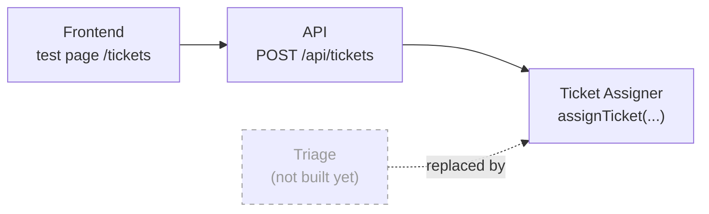
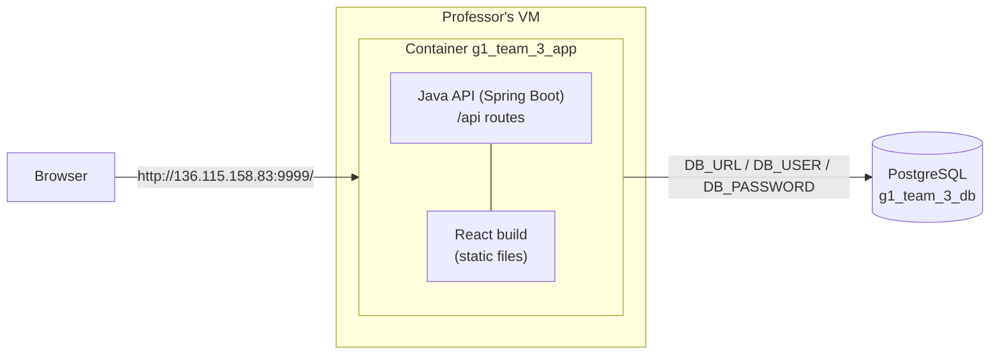
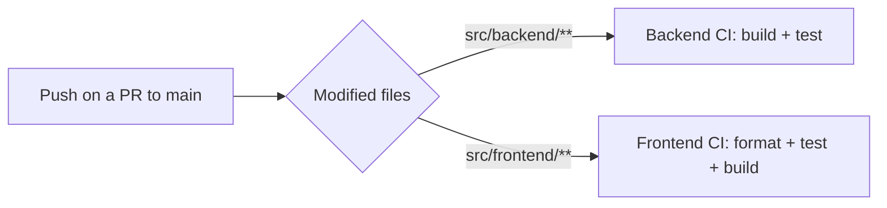

# Delivery 1 — How the application works

| | |
|---|---|
| **Project** | Adres en Urgencias |
| **Team** | Group 3 |
| **Live application** | <http://136.115.158.83:9999/> |
| **Use case delivered** | Use case 1 — *Add a patient to the waiting queue* (REQ-04), as described in [Interaction & Data Design v2](../../../dev/design/02_Interaction_and_Data_Design_v2.md), section 1.1 |

> **Language note.** The design documents are written in Spanish. From this delivery on, the project moves to English, so class and operation names are used here in their English form. Mapping: `AsignadorDeTurno` → **Ticket Assigner**, `GestionadorColaPrioridad` → **Priority Queue Manager**, `ColaPorNivel` → **Level Queue**, `Turno` → **Ticket**, `asignarTurno` → **`assignTicket`**, `anadirPaciente` → **`addPatient`**, `Paciente` → **Patient**, `NivelTriage` → **Triage Level**.

---

## 1. What is done

### 1.1 Scope: use case 1

The delivered feature is **use case 1 of the Interaction & Data Design v2 (section 1.1): add a patient to the waiting queue** (requirement REQ-04). Once a patient has been classified by Triage, the system:

1. **checks the data**: patient id, document, first and last name must be filled in, and the Triage level must be a number from 1 to 5;
2. **handles level 1 separately**: level 1 means immediate care, so the patient is registered but gets **no ticket and no place in a queue** (BR-TRG-03);
3. **rejects duplicates**: a patient who already has a waiting ticket cannot get a second one;
4. **generates a ticket number** made of the level and a counter that restarts every day, e.g. `T3-015` is the 15th ticket of the day for level 3 (BR-TRG-04). The "day" follows the hospital's time zone (Bogotá), so counters restart at local midnight;
5. **places the ticket at the end of the queue of its level**: inside a level, the order of arrival is respected (BR-TRG-02).

This logic lives in the **Ticket Assigner** module ("Ticket management" scope of the design): the **Ticket Assigner**, the **Priority Queue Manager** and the **Level Queue**. It is plain business code, independent from the web framework and from the database, which makes it easy to test.

**All-or-nothing guarantee.** Saving the patient, increasing the counter and creating the ticket happen in **one database transaction**. If anything fails (for example a duplicate patient), nothing is kept: no ticket number is "burned" and no half-created ticket remains (BR-TRG-05). This replaces the "revert the counter" step of the sequence diagram, as the design itself recommended.

### 1.2 The problem: there is no Triage module yet

In the design, the sequence diagram starts with a **Triage** module calling `assignTicket(patientId, level)` on the Ticket Assigner. Triage is an **external module** to the Ticket management scope, and we do not have an architecture or design for it yet. The first screenshot shows the two modules involved in the sequence diagram:

*Left (red): the Triage module, outside our scope. Right (red): the Ticket Assigner module, which is the core of the use case.*

### 1.3 The decision: a temporary API route + a temporary front-end page

Instead of building Triage, we **replace it with two temporary pieces** that let us test the real core of the use case (the Ticket Assigner) end to end:

| Piece | What it does |
|---|---|
| **Frontend page `/tickets` (temporary)** | A form where the user types **all the patient data by hand** (patient id, document, first name, last name) **plus the Triage level**, and presses a button to send them to the API. The answer is shown on the same page: the assigned ticket and its position, "immediate care" for level 1, or an error message. |
| **API route `POST /api/tickets` (temporary)** | Receives the patient data and the Triage level, **stores the patient** in the database and **calls `assignTicket`** of the Ticket Assigner module, all in one transaction. |
| **Ticket Assigner** | The real core of the use case, as described in the sequence diagram. |

What this means for the design:

- **The Triage participant of the sequence diagram is played by the API route.** It is the caller of `assignTicket`, and it gets the answers Triage would get: the assigned ticket, an *invalid data* error or a *duplicate patient* error.
- **Triage and Registration are simulated by the page.** The form sends the identification data that Registration would provide and the Triage level that Triage would provide. The patient is stored with that data, because the `patient` table needs it.
- **Nothing inside the Ticket Assigner depends on the temporary pieces.** When the real Triage module exists, it will call `assignTicket` directly; the temporary page and the shape of the request will change, but the core will not.

### 1.4 What the application answers

| Situation | HTTP answer | What the user sees on the page |
|---|---|---|
| Level 2 to 5, new patient | `201` | The ticket number (e.g. `T3-015`) and the position in the queue of its level |
| Level 1 | `200` | "Immediate care": no ticket, no queue |
| Missing or malformed data | `400` `INVALID_DATA` | An error message pointing at the faulty field |
| The patient already has a waiting ticket | `409` `DUPLICATE_PATIENT` | A duplicate error; the existing ticket is untouched |

A second route, `GET /api/tickets`, returns the **waiting queue**, most urgent level first and, inside a level, in arrival order. It is a small addition to verify the result of the assignments.

### 1.5 Data model

The schema follows sections 2.2 and 2.4 of the design document and is created automatically by database migrations (Flyway) when the application starts:

| Table | Role in use case 1 |
|---|---|
| `triage_level` | The five Triage levels (1 to 5). Reference data. |
| `patient` | Identification data and current Triage level. |
| `ticket_counter` | Last ticket number issued per day and per level (levels 2 to 5). |
| `level_queue` | One FIFO queue per level (levels 2 to 5). |
| `ticket` | The ticket: number, patient, arrival time, level, position in the queue, exit time. |
| `wait_limit` | Maximum waiting time per level (prepared for use case 2, not used here). |

Several business rules are also enforced by the database itself, as a second line of defense: one waiting ticket per patient, one position per level among waiting tickets, one ticket number per day, and queues/counters/tickets only for levels 2 to 5.

### 1.6 Differences with the design documents

The code makes a few choices that the design documents do not state yet. They are recorded in **ADR-0006** (pull request #35), and the design documents will be updated accordingly:

- the request carries the identification data of the patient, not only `patientId` and `level` (Registration is simulated);
- level 1 is a valid request answered with "immediate care" (as in REQ-04, scenario 2), whereas the design contract listed it as invalid input;
- error codes and class names are in English (`INVALID_DATA`, `DUPLICATE_PATIENT`, `TicketAssigner`...);
- ticket days follow the Bogotá time zone.

### 1.7 Out of scope for this delivery

- The real **Triage** module (replaced by the temporary route + page).
- Use case 2 of the design (serving the most urgent patient, wait limits, REQ-10 to REQ-12) and changing the level of a waiting patient (REQ-05).
- A proper display of the priority queue: for now it only has a temporary display on the ticket creation page.

---

## 2. Technical part

### 2.1 Application architecture

The application is **a single Java API (Spring Boot) that also serves the web files produced by the build of our React front end**. There is one deployable unit and one origin: the browser loads the React app from the API server, and the React app calls the API under `/api`.

The Docker image is built in three stages (`infra/Dockerfile`): build the React front end → copy its output into the Spring Boot jar (as static resources) → run the jar on a minimal Java runtime. Browser routes of the React app (e.g. a page refresh) fall back to `index.html`, while unknown `/api` paths stay 404.

### 2.2 Continuous integration — on every push to a pull request targeting `main`

Every push to a pull request whose target is `main` can trigger **up to two verification pipelines**, depending on which files were modified:

| Pipeline | Triggered when the PR changes… | What it does |
|---|---|---|
| **Backend CI** (`.github/workflows/backend.yml`) | `src/backend/**` or the workflow file | Sets up JDK 25 and runs the backend **build + tests** (`./mvnw test`). |
| **Frontend CI** (`.github/workflows/frontend.yml`) | `src/frontend/**` or the workflow file | Sets up Node 24, then runs `npm ci`, the **format check**, the **tests** and the **build** (`npm run build`). |

A pull request that touches both folders triggers both pipelines; one that touches only documentation triggers none.

### 2.3 Continuous deployment — on every push to `main`

Every push to `main` (that is, every merged pull request) triggers the **deployment pipeline** (`.github/workflows/deploy.yml`) towards the **professor's VM**. Runs never overlap. Steps:

1. Build the Docker image (front end + back end together) tagged with the commit SHA and `latest`.
2. Open an SSH connection to the VM with the deployment key (stored as a GitHub secret).
3. Generate the `.env` file from GitHub secrets (database URL, user and password) and upload it with `compose.yml`.
4. Transfer the image to the VM (`docker save` → SSH → `docker load`).
5. Start it with `docker compose up -d`.
6. Wait until the container health check reports `healthy`; otherwise the job fails and prints the last logs.

The whole application runs in **one single container, named `g1_team_3_app`**.

### 2.4 Database

The deployed application uses the database **`g1_team_3_db`** with the user **`g1_team_3_user`**. There is no database container in our deployment: the database is provided by the professor and the application reaches it through the `DB_URL`, `DB_USER` and `DB_PASSWORD` environment variables (the password is a GitHub secret and is never committed). On startup, **Flyway** applies the schema migrations to this database.

### 2.5 Accessing the application

| | |
|---|---|
| **URL** | <http://136.115.158.83:9999/> |
| **Container** | `g1_team_3_app` |
| **Database** | `g1_team_3_db` (user `g1_team_3_user`) |

Further technical details: [Deployment guide](../../../dev/code/deploy.md) (ADR-0005), [Backend setup](../../../dev/code/backend_setup.md), [Frontend setup](../../../dev/code/frontend_setup.md), [Database migrations](../../../dev/code/database_migrations.md).
