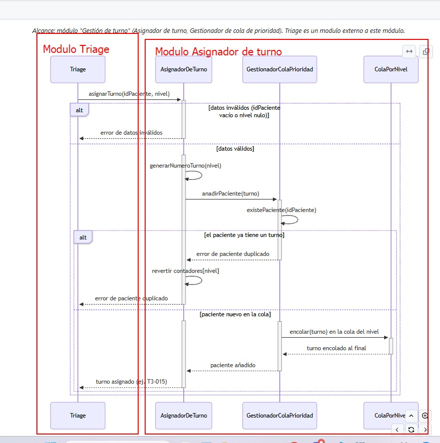
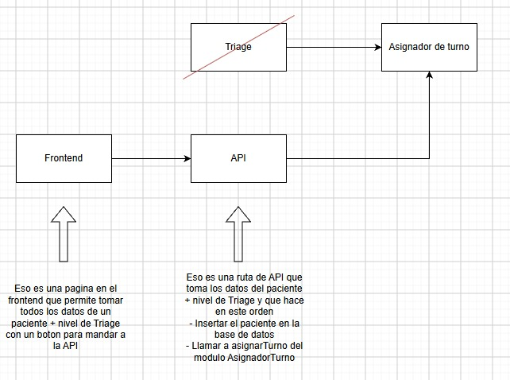
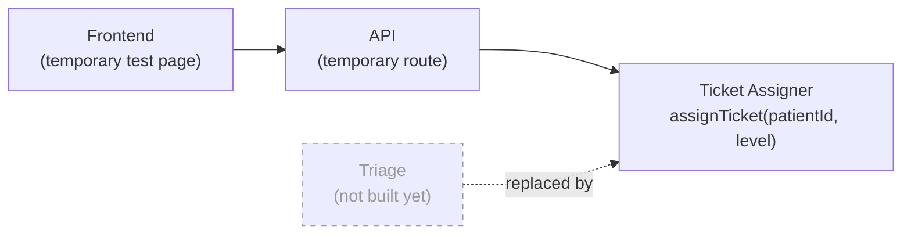
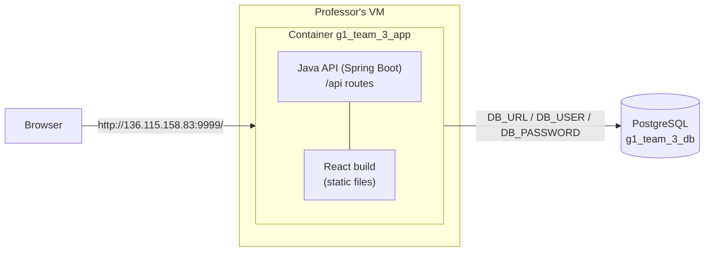
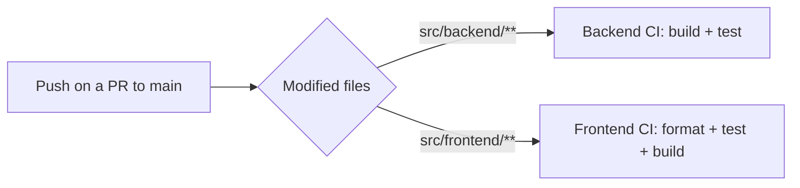

# Delivery 1 — How the application works

| | |
|---|---|
| **Project** | Adres en Urgencias |
| **Team** | Group 3 |
| **Live application** | <http://136.115.158.83:9999/> |
| **Use case delivered** | Use case 1 — *Add a patient to the waiting queue* (REQ-04), as described in [Interaction & Data Design v2](../../../dev/design/02_Interaction_and_Data_Design_v2.md), section 1.1 |

> **Language note.** The design documents are written in Spanish. From this delivery on, the project moves to English, so class and operation names are used here in their English form. Mapping: `AsignadorDeTurno` → **Ticket Assigner**, `GestionadorColaPrioridad` → **Priority Queue Manager**, `ColaPorNivel` → **Level Queue**, `Turno` → **Ticket**, `asignarTurno` → **`assignTicket`**, `anadirPaciente` → **`addPatient`**, `Paciente` → **Patient**, `NivelTriage` → **Triage Level**.

---

## 1. What is done

### 1.1 Scope: use case 1

The delivered feature is **use case 1 of the Interaction & Data Design v2 (section 1.1): add a patient to the waiting queue**. Once a patient has been classified, the system:

1. validates the data (patient id not blank, triage level between 2 and 5);
2. generates a ticket number per level and per day (e.g. `T3-015`);
3. checks that the patient does not already have a waiting ticket;
4. places the new ticket at the end of the queue of its triage level (arrival order inside a level, BR-TRG-02).

This logic lives in the **Ticket Assigner** module ("Ticket management" scope in the design document): the Ticket Assigner, the Priority Queue Manager and the Level Queue. The three writes (daily counter, ticket, queue position) happen in **one database transaction**: if the patient is a duplicate, everything is rolled back, so a ticket number is consumed only if the ticket is created.

### 1.2 The problem: there is no Triage module yet

In the design, the sequence diagram starts with a **Triage** module calling `assignTicket(patientId, level)` on the Ticket Assigner. Triage is an **external module** to the Ticket management scope, and we do not have an architecture or design for it yet. The first screenshot shows the two modules involved in the sequence diagram:

*Left (red): the Triage module, outside our scope. Right (red): the Ticket Assigner module, which is the core of the use case.*

### 1.3 The decision: a temporary API route + a temporary front-end page

Instead of building Triage, we **replace it with two temporary pieces** that let us test the real core of the use case (the Ticket Assigner) end to end:

| Piece | What it does |
|---|---|
| **Frontend page (temporary)** | A page in the React front end where the user types **all the patient data by hand** (patient id, document, first name, last name) **plus the Triage level**, and presses a button that sends them to the API. |
| **API route (temporary)** | Receives the patient data + Triage level and does, **in this order**: **(1)** insert the patient in the database; **(2)** call `assignTicket` of the Ticket Assigner module. |
| **Ticket Assigner** | Unchanged from the design: it is the real core of the use case, exactly as described in the sequence diagram. |

What this means for the design:

- **The Triage participant of the sequence diagram is played by the API route.** It is the caller of `assignTicket(patientId, level)`, and it receives the same answers Triage would receive: the assigned ticket (e.g. `T3-015`), an *invalid data* error, or a *duplicate patient* error.
- **The patient insertion is done by the route**, not by the Ticket Assigner. This matches the data ownership in the design (section 2.3): the `patient` data (identification + Triage level) comes from outside the Ticket Assigner (Registration / Triage in the design), and the Ticket Assigner only consumes it.
- **Nothing inside the Ticket Assigner depends on the temporary pieces.** When the real Triage module exists, it will call `assignTicket` directly and the temporary route and page can be removed without touching the core.

### 1.4 Data model

The database schema follows section 2.2 and 2.4 of the design document and is created by Flyway migrations (`src/backend/src/main/resources/db/migration`), applied automatically when the application starts:

| Table | Role in use case 1 |
|---|---|
| `triage_level` | The five Triage levels (1 to 5). Reference data. |
| `patient` | Identification data and current Triage level. Inserted by the API route. |
| `ticket_counter` | Last ticket number issued per day and per level (levels 2 to 5). |
| `level_queue` | One FIFO queue per level (levels 2 to 5). |
| `ticket` | The ticket (number, patient, arrival time, level, position, exit time). |
| `wait_limit` | Maximum waiting time per level (reference data, used by use case 2, not by this delivery). |

Business rules enforced by the database itself: one waiting ticket per patient (partial unique index), unique position per level among waiting tickets, unique ticket number per day, levels 2–5 only for queues/counters/tickets (level 1 never enters a queue, BR-TRG-03).

### 1.5 Out of scope for this delivery

- The real **Triage** module (replaced by the temporary route + page, see 1.3).
- Use case 2 of the design (removing the highest-priority patient from the queue, REQ-11) and queue display screens.

---

## 2. Technical part

### 2.1 Application architecture

The application is **a single Java API (Spring Boot) that also serves the web files produced by the build of our React front end**. There is one deployable unit and one origin: the browser loads the React app from the API server, and the React app calls the API under `/api`.

The Docker image is built in three stages (`infra/Dockerfile`): build the React front end → copy its output into the Spring Boot jar (as static resources) → run the jar on a minimal Java runtime. Browser routes of the React app (e.g. a page refresh) fall back to `index.html`, while unknown `/api` paths stay 404.

### 2.2 Continuous integration — on every push to a pull request targeting `main`

Every push to a pull request whose target is `main` can trigger **up to two verification pipelines**, depending on which files were modified:

| Pipeline | Triggered when the PR changes… | What it does |
|---|---|---|
| **Backend CI** (`.github/workflows/backend.yml`) | `src/backend/**` or the workflow file | Sets up JDK 25 and runs the backend **build + tests** (`./mvnw test`). |
| **Frontend CI** (`.github/workflows/frontend.yml`) | `src/frontend/**` or the workflow file | Sets up Node 24, then runs `npm ci`, the **format check**, the **tests** and the **build** (`npm run build`). |

A pull request that touches both folders triggers both pipelines; one that touches only documentation triggers none.

### 2.3 Continuous deployment — on every push to `main`

Every push to `main` (that is, every merged pull request) triggers the **deployment pipeline** (`.github/workflows/deploy.yml`) towards the **professor's VM**. Runs never overlap. Steps:

1. Build the Docker image (front end + back end together) tagged with the commit SHA and `latest`.
2. Open an SSH connection to the VM with the deployment key (stored as a GitHub secret).
3. Generate the `.env` file from GitHub secrets (database URL, user and password) and upload it with `compose.yml`.
4. Transfer the image to the VM (`docker save` → SSH → `docker load`).
5. Start it with `docker compose up -d`.
6. Wait until the container health check reports `healthy`; otherwise the job fails and prints the last logs.

The whole application runs in **one single container, named `g1_team_3_app`**.

### 2.4 Database

The deployed application uses the database **`g1_team_3_db`** with the user **`g1_team_3_user`**. There is no database container in our deployment: the database is provided by the professor and the application reaches it through the `DB_URL`, `DB_USER` and `DB_PASSWORD` environment variables (the password is a GitHub secret and is never committed). On startup, **Flyway** applies the schema migrations to this database.

### 2.5 Accessing the application

| | |
|---|---|
| **URL** | <http://136.115.158.83:9999/> |
| **Container** | `g1_team_3_app` |
| **Database** | `g1_team_3_db` (user `g1_team_3_user`) |

Further technical details: [Deployment guide](../../../dev/code/deploy.md) (ADR-0005), [Backend setup](../../../dev/code/backend_setup.md), [Frontend setup](../../../dev/code/frontend_setup.md), [Database migrations](../../../dev/code/database_migrations.md).
