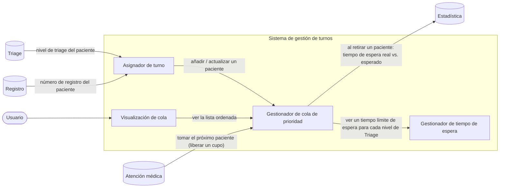
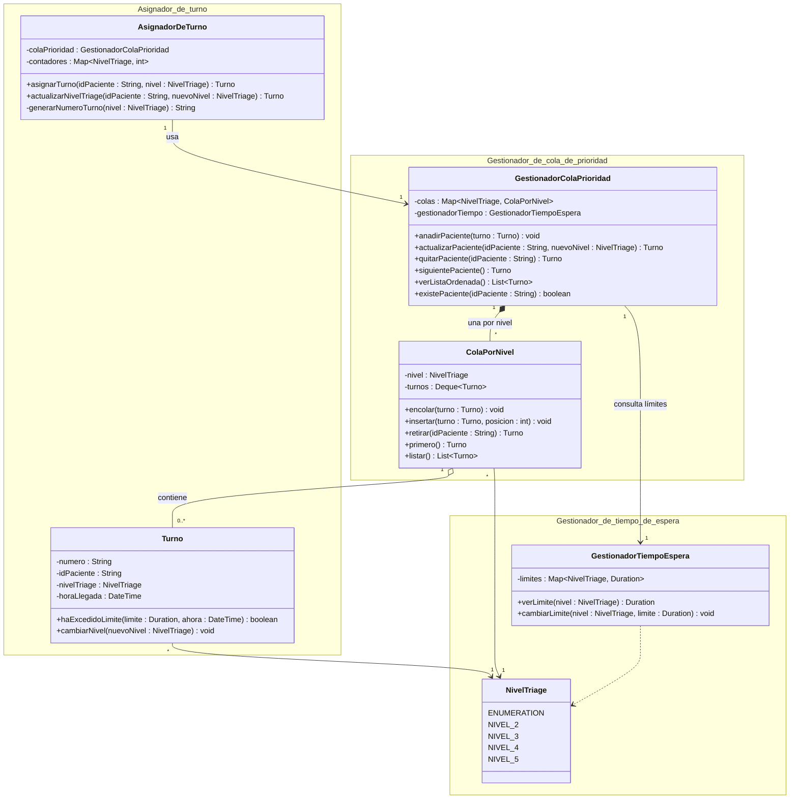

<!--
HOW TO USE THIS TEMPLATE
------------------------
1. Copy this file to docs/design/01_Architectural_and_Detailed_Design.md in your team repository.
2. This is v1.0 of work you already started: your Class 11 "Architectural Hypothesis v0.1"
   and your Class 12 "Detailed Design v0.1". Extend them to your whole system. Do not restart.
3. Use YOUR project. Generic examples (e-commerce, food delivery, banking, library) are
   only reference material and cannot be submitted as project artifacts.
4. Fill in every section. If something genuinely does not apply, write "N/A: reason".
   Never invent content to fill a blank.
5. Every diagram needs the table or argument that explains it. A diagram records design
   decisions. It does not create them.
6. Diagrams: Mermaid is preferred because it renders on GitHub. PlantUML or another tool is
   accepted if the exported image is committed and embedded in this file.
   Optionally, also add a JPG of each diagram in docs/design/diagrams/ (the Markdown prevails if they differ).
7. Read Design_Deliverable_1_Example.md for the expected level of detail. Do not copy it.
-->

# Adres en Urgencias — Architectural & Detailed Design v1.0

| **Team**    | Grupo 3                                                                                                                                                                                       |
|-------------|-----------------------------------------------------------------------------------------------------------------------------------------------------------------------------------------------|
| **Members** | - Bryan Gustavo Llontop Angulo (@BLlontopSec) - Diego Stevan Anacona Velez (@elDIEGO12) - Diego Ibáñez (@Dielix22) - Adrien ROHO (@hoverwars) - Sebastian Eisneider Rey Pretel (@sereypretel) |
| **Status**  | Ready for review                                                                                                                                                                              |
| **Date**    | 17/10/2026                                                                                                                                                                                    |
| **Inputs**  | `docs/requirements/`, Architectural Hypothesis v0.1 (Class 11), Detailed Design v0.1 (Class 12)                                                                                               |

---

## 1. System Overview & Design Drivers

Este diseño es necesario porque implementa la cola de priorizacion de los pacientes dentro del hospital. Ademas, propone una idea para priorizar a las pacientes para que esperen demasiado tiempo.

**Requirements that shape the structure**:

| Requirement Use Case ID | Why it shapes the structure                                                                                                                           | Quality attribute, constraint or business rule involved |
|---------------------------|-------------------------------------------------------------------------------------------------------------------------------------------------------|---------------------------------------------------------|
| REQ-04                    | Introduce la nocion de turno y de fila de priorizacion                                                                                                | BR-TRG-02, BR-TRG-03                                    |
| REQ-10                    | Es posible editar el tiempo de espera para cada nivel de triage, excluyendo el nivel 1 que necesita una atencion inmediata |                                                         |
| REQ-11                    | El sistema debe quitar el paciente mas priorizado de la cola para darle atencion medica |                                                         |
---

## 2. Architectural Design

*(Outward-facing: what are the major parts, what is each responsible for, how do they interact?)*

### 2.1 System Context & Boundary

| Outside the system | Type (actor / external system / hardware) | How the system interacts with it                                                                                                                                              |
|--------------------|-------------------------------------------|-------------------------------------------------------------------------------------------------------------------------------------------------------------------------------|
| Triage             | Sistema interna                           | El sistema de gestion de turno se basa completamente en la atribucion del nivel de triage a cada paciente para atribuir un numero de turno o reordenar la cola de pacientes.  |
| Registro           | Sistema interna                           | El sistema de gestion de turno identifica a los pacientes con su numero de registracion                                                                                       |
| Estadistica        | Sistema interna                           | El sistema manda eventos al sistema de estadistica para guardar los tiempos calculados y aumentar la calidad el sistema en el futuro                                          |
| Atencion medica    | Sistema interna                           | El sistema de atencion medica puede tomar el proximo paciente (liberar un cupo)                                                                                               |

### 2.2 Components, Responsibilities & Capabilities

Cover the principal functional scope of your whole system.



*(Everything inside `SYS` is what you build and control. Everything outside is what you only interact with. Label each arrow with the capability being requested.)*

| Component                        | Main responsibility                                                                                                             | Requirements / use cases supported | Provided capabilities                                                                                | Required capabilities                            | Main dependencies                |
|----------------------------------|---------------------------------------------------------------------------------------------------------------------------------|------------------------------------|------------------------------------------------------------------------------------------------------|--------------------------------------------------|----------------------------------|
| Asignador de turno               | Con el resultado de Triage, pone el paciente en la cola y se le asigna un turno. <br> Actualizar un paciente de nivel de Triage | REQ-04                             | Asignar un turno, <br> Actualizar un nivel de Triage                                                 | Anadir a un paciente <br> Actualizar un paciente | Gestionador de cola de prioridad |
| Gestionador de tiempo de espera  | Ver el tiempo limite de espera para un nivel de Triage, configurar un tiempo limite de espera para un nivel de Triage           | REQ-10                             | Ver un tiempo limite de espera <br> Cambiar un tiempo limite de espera                               |                                                  |                                  |
| Gestionador de cola de prioridad | Anadir a un paciente en la cola, listar los pacientes en la cola, quitar a un paciente, insertar a un paciente                  | REQ-04, REQ-11             | Anadir un paciente <br> Actualizar un paciente <br>  Quitar a un paciente <br> Ver la lista ordenada | Ver un tiempo limite de espera                   | Gestionador de tiempo de espera  |
| Visualizacion de cola            | Mostrar el estado de la cola de prioridad en tiempo real                                                                        | REQ-06                             | Mostrar la cola de prioridad sobre la pantalla de usuario                                            | Ver la lista ordenada                            | Gestionador de cola de prioridad |
| | | | | | |


---

## 3. Detailed Design

*(Inward-facing: how is each selected component designed internally?)*

### 3.1 Components selected (at least two)

| Componente | Por qué fue seleccionado (riesgo, complejidad, centralidad respecto a los drivers) |
|---|---|
| Asignador de turno | Es el punto de entrada del sistema: recibe el resultado de Triage y es el único que decide cuándo se crea o se reasigna un turno (REQ-04). |
| Gestionador de cola de prioridad | Es el componente más central y complejo: concentra la lógica de ordenamiento (REQ-04) y el respeto del tiempo máximo de espera (REQ-11). |
| Gestionador de tiempo de espera | Es el origen de los límites de espera por nivel de Triage (REQ-10); la cola de prioridad depende de él para aplicar REQ-11. |

*El componente "Visualización de cola" queda fuera del alcance de este diseño detallado.*

### 3.2 Class Diagram(s)



*Propuesta inicial, a iterar. Decisiones de base: (1) cuatro colas FIFO, una por nivel de Triage (niveles 2 a 5); (2) `siguientePaciente()` recorre las colas del nivel 2 al nivel 5, pero prioriza antes a un turno que haya excedido su límite de espera (REQ-11); (3) `actualizarPaciente` retira el turno de su cola actual y lo reubica en la del nuevo nivel.*

### 3.3 Class Responsibilities

| Clase | Componente al que pertenece | Responsabilidad | Colaboradores principales |
|---|---|---|---|
| AsignadorDeTurno | Asignador de turno | Crear un turno a partir del resultado de Triage y reasignarlo cuando cambia el nivel de Triage del paciente. | GestionadorColaPrioridad, Turno |
| Turno | Asignador de turno | Representar el turno de un paciente (número, nivel, hora de llegada) y saber si excedió su límite de espera. | NivelTriage |
| GestionadorColaPrioridad | Gestionador de cola de prioridad | Ofrecer la fachada de la cola: añadir, actualizar, quitar y listar pacientes, y decidir quién es el siguiente según nivel y límite de espera. | ColaPorNivel, GestionadorTiempoEspera |
| ColaPorNivel | Gestionador de cola de prioridad | Mantener en orden de llegada los turnos de un único nivel de Triage. | Turno, NivelTriage |
| GestionadorTiempoEspera | Gestionador de tiempo de espera | Guardar y consultar el tiempo límite de espera de cada nivel de Triage. | NivelTriage |
| NivelTriage | Gestionador de tiempo de espera | Enumerar los cuatro niveles de Triage, compartidos por todos los componentes. | — |

### 3.4 Behavior of one key operation

*(The operation you designed in Class 12, or a more important one. At most about 15 lines. Include at least one non-happy path.)*

Operación: asignar un turno a un paciente y añadirlo a la cola (`asignarTurno` → `anadirPaciente`).

```text
AsignadorDeTurno.asignarTurno(idPaciente, nivel):
  1. Si nivel es nulo o idPaciente es vacío -> rechazar con error de datos inválidos.
  2. numero <- generarNumeroTurno(nivel)                           // ej. "T3-015"
  3. turno <- nuevo Turno(numero, idPaciente, nivel, horaActual)
  4. GestionadorColaPrioridad.anadirPaciente(turno):
       4.1 Si ya existe un turno para idPaciente en alguna cola
             -> revertir contadores[nivel], rechazar con error de paciente duplicado.
       4.2 colas[nivel].encolar(turno)                             // al final de la cola
  5. Devolver turno.

Camino no feliz (paciente duplicado):
  El paciente ya tiene un turno -> no se crea un segundo turno, el contador
  del nivel no avanza y el turno existente queda intacto.
```

---

## 4. Design Quality — Cohesion, Coupling, Information Hiding

| Question | Your answer, with evidence from your design |
|---|---|
| **Cohesión:** ¿las responsabilidades dentro de cada clase o componente van juntas? | Cada clase tiene una sola razón de cambio. `ColaPorNivel` solo mantiene el orden de llegada de un nivel; `GestionadorColaPrioridad` decide el orden global entre niveles (recorrido de nivel 2 a 5 y prioridad por límite excedido, REQ-11); `GestionadorTiempoEspera` solo guarda y consulta límites (REQ-10); `AsignadorDeTurno` solo crea el turno y su número. Punto más débil: `GestionadorColaPrioridad` agrupa añadir, actualizar, quitar, listar y elegir al siguiente; sigue coherente porque todas operan sobre el mismo conjunto de colas, pero es la clase más propensa a crecer. |
| **Acoplamiento:** ¿hasta dónde se propaga un cambio en un elemento? ¿Dónde están las dependencias más fuertes? | Las dependencias entre componentes son unidireccionales y coinciden con la tabla de la sección 2.2: `AsignadorDeTurno` → `GestionadorColaPrioridad` → `GestionadorTiempoEspera`; no hay ciclos. La dependencia más fuerte es `NivelTriage`, usado por las cinco clases: añadir o quitar un nivel afecta el enum, `contadores`, `colas` y `limites`. `Turno` también es compartido entre el Asignador (que lo crea) y la cola (que lo almacena y lo reordena). |
| **Ocultamiento de información:** ¿qué se mantuvo privado o interno y por qué? | Los atributos son privados en todas las clases: ninguna clase interactúa directamente con las variables internas de otra, solo con sus operaciones públicas. Los `contadores` y `generarNumeroTurno` quedan dentro de `AsignadorDeTurno`, de modo que el formato del número de turno puede cambiar (ver Q1 de REQ-04) sin afectar a otros componentes y nadie más puede modificarlo (CON-TRG-02). Las `ColaPorNivel` solo son accesibles a través de `GestionadorColaPrioridad`: los demás componentes no saben que existe una cola por nivel ni cómo se recorren. `Deque` y `Map` no aparecen en ninguna operación pública. |

**At least one real finding** (a problem you found in your own design) **and what you changed or would change:**
> **Hallazgo:** en el punto 3.4, el paso 4.1 (paciente duplicado) obliga a "revertir `contadores[nivel]`" después de que `generarNumeroTurno` ya incrementó el contador. Eso significa que `GestionadorColaPrioridad` provoca que `AsignadorDeTurno` deshaga un estado interno suyo, y que el número solo es válido si la operación posterior tiene éxito: el ocultamiento de información y el orden de las operaciones quedan mal diseñados. Además, si el número ya fue consumido por un turno rechazado, la secuencia diaria tendría huecos.

---

## 5. Design Decisions & Decision Record

Two decisions are required: one architectural (Class 11 level) and one detailed-design (Class 12 level). Avoid "it is best practice", "it scales" or "it is cleaner" without project evidence.

### Decision A — Architectural

| | |
|---|---|
| **Contexto** (requisito, restricción o problema que lo motivó) | REQ-10 exige que el tiempo límite de espera de cada nivel de Triage sea editable, y REQ-11 exige que la cola respete ese límite. Si los límites vivieran dentro de la cola, cambiar una configuración implicaría tocar la lógica de ordenamiento. |
| **Decisión** | Aislar los límites de espera en un componente propio, *Gestionador de tiempo de espera*, que solo ofrece "ver" y "cambiar" un límite. *Gestionador de cola de prioridad* lo consulta (dependencia unidireccional) y no lo modifica. |
| **Justificación** (por qué es razonable aquí) | REQ-10 y REQ-11 tienen orígenes distintos: uno es de configuración, el otro de ordenamiento. Con la separación, la cola solo necesita la capacidad "ver un tiempo límite de espera para cada nivel de Triage", y la pantalla de configuración (REQ-10) puede evolucionar sin tocar la cola. |
| **Compromiso aceptado** | Un componente adicional y una consulta entre componentes cada vez que la cola decide quién es el siguiente paciente. Con solo cuatro niveles el costo es bajo, pero hay que mantener la interfaz entre ambos. |

### Decision B — Detailed design

| | |
|---|---|
| **Contexto** | Según la sección 1, REQ-04 introduce el turno y la fila de priorización, y REQ-11 impone un tiempo máximo de espera por nivel de Triage. La estructura de la fila debe permitir ordenar por nivel, reubicar pacientes y detectar a quien excedió su límite. |
| **Decisión** | Representar la cola como una `ColaPorNivel` por cada nivel de Triage, administradas por `GestionadorColaPrioridad`, en lugar de una única lista ordenada por un comparador. `siguientePaciente()` recorre los niveles en orden y prioriza antes a un turno que excedió su límite. |
| **Justificación** | Dentro de un mismo nivel, el orden de llegada se cumple por construcción: encolar al final de la cola del nivel basta. Reubicar por cambio de nivel es retirar de una cola y encolar en otra, sin reordenar toda la lista. El primer turno de cada cola es el más antiguo del nivel, así que verificar REQ-11 solo requiere revisar cuatro turnos. |
| **Compromiso aceptado** | Se necesita lógica adicional para fusionar las colas al listar (`verListaOrdenada`) y para aplicar la excepción de REQ-11, y hay más objetos que una sola lista. Además, `GestionadorColaPrioridad` conoce la existencia de varios niveles, lo que la acopla a `NivelTriage`. |

### ADR

**ADR file:** [`docs/decisiones/ADR-0002-cola-de-prioridad-por-nivel-de-triage.md`](decisiones/ADR-0002-cola-de-prioridad-por-nivel-de-triage.md) — records Decision A and Decision B.

---

## 6. Traceability

| Requirement ID | Caso de uso | Componente(s) | Clase(s) |
|---|---|---|---|
| REQ-04 | Asignar un turno según el resultado de Triage | Asignador de turno, Gestionador de cola de prioridad | AsignadorDeTurno, Turno, GestionadorColaPrioridad, ColaPorNivel, NivelTriage |
| REQ-10 | Editar el tiempo límite de espera de un nivel de Triage | Gestionador de tiempo de espera | GestionadorTiempoEspera, NivelTriage |
| REQ-11 | Priorizar a un paciente que excedió el límite de espera | Gestionador de cola de prioridad, Gestionador de tiempo de espera | GestionadorColaPrioridad, ColaPorNivel, Turno, GestionadorTiempoEspera |

*(Every requirement in Section 1 must appear. Every component and class should appear at least once. If an element traces to nothing, ask why it exists.)*

---

## 7. Optional — AI-Assisted Design Reflection

> One design recommendation generated by AI that the team accepted, modified or rejected, and why.

---

## 8. Consistency Checklist

- [X] Every component in the diagram appears in the responsibilities table, and the other way around.
- [X] Every class belongs to an identifiable component.
- [X] Components are named by responsibility, not technology.
- [X] Nothing inside the system boundary is something you do not control.
- [X] Provided and required capabilities match across components (what one requires, another provides).
- [X] Both decisions name a real cost or limitation, and at least one has an ADR.
- [X] The traceability table has no empty rows and no orphan components or classes.
- [X] Diagrams render correctly on GitHub (or the exported images are embedded).
