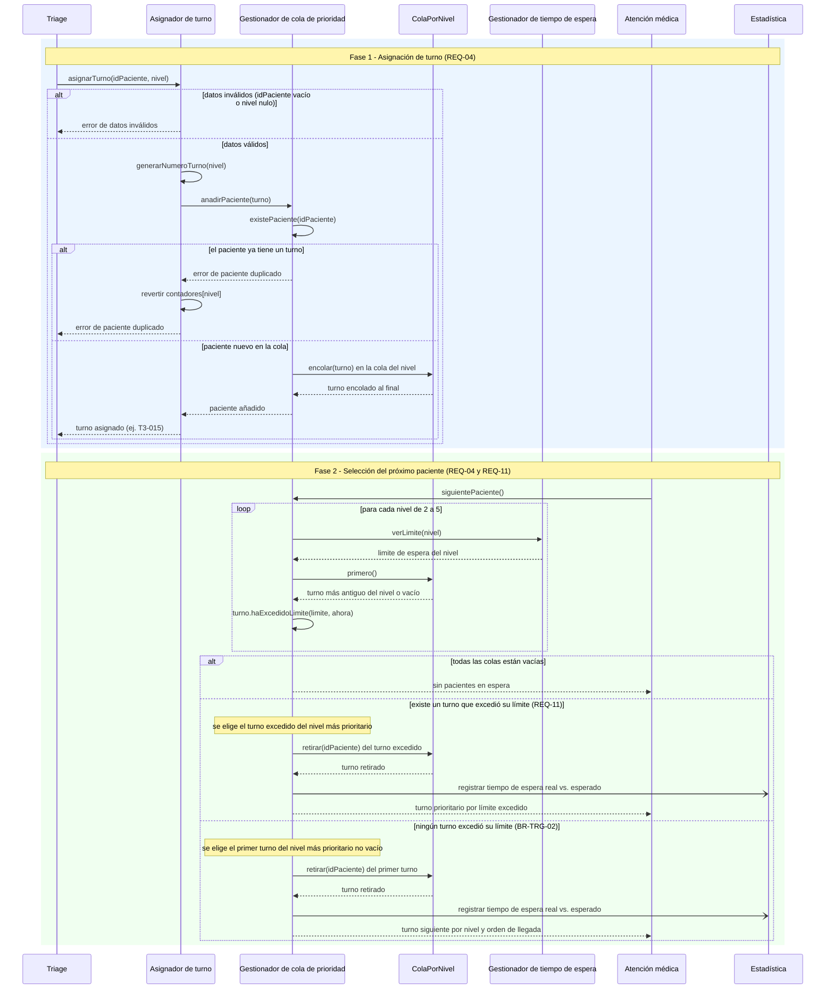
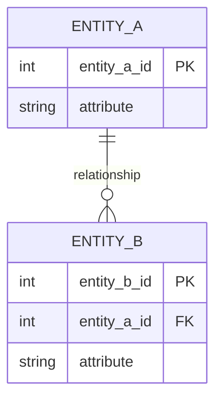

# Adres en Urgencias — Interaction & Data Design v1.0 (REQ-04 y REQ-11)

| **Team**    | Grupo 3                                                                                                                                                                                       |
|-------------|-----------------------------------------------------------------------------------------------------------------------------------------------------------------------------------------------|
| **Members** | - Bryan Gustavo Llontop Angulo (@BLlontopSec) - Diego Stevan Anacona Velez (@elDIEGO12) - Diego Ibáñez (@Dielix22) - Adrien ROHO (@hoverwars) - Sebastian Eisneider Rey Pretel (@sereypretel) |
| **Status**  | Ready for review                                                                                                                                                                              |
| **Date**    | 25/10/2026                                                                                                                                                                                    |
| **Inputs** | `docs/design/01_Architectural_and_Detailed_Design.md`, Use Cases in `docs/requirements/`, Interaction & Contracts Design v0.1 (Class 13) |

---

## 1. Behavior — Selected Use Cases

Select **two** important use cases from your own project that involve meaningful interaction between components. One of them should be the use case of your capstone requirement.

### 1.1 Asignación de turno y selección del próximo paciente por orden de prioridad — from requirement REQ-04 y REQ-11

*Versión inicial, a iterar. Alcance: módulo "Gestión de turno" (Asignador de turno, Gestionador de cola de prioridad, Gestionador de tiempo de espera). Triage, Atención médica y Estadística son sistemas externos al módulo.*



| Use Case step or flow | Message(s) in the diagram | Information exchanged | Operation defined in (Deliverable 1) |
|---|---|---|---|
| Main flow, step 1: Triage entrega el resultado | `asignarTurno(idPaciente, nivel)` | Número de registro del paciente y nivel de Triage (2 a 5) | `AsignadorDeTurno.asignarTurno` (sec. 3.2, 3.4) |
| Main flow, step 2: se genera el número de turno | `generarNumeroTurno(nivel)` | Nivel → número con formato `T3-015`, contador diario por nivel | `AsignadorDeTurno.generarNumeroTurno` (privada, sec. 3.2) |
| Main flow, step 3: se posiciona al paciente en la cola | `anadirPaciente(turno)`, `encolar(turno)` | `Turno` (número, idPaciente, nivel, horaLlegada); queda al final de los turnos de su nivel (BR-TRG-02, desempate por llegada) | `GestionadorColaPrioridad.anadirPaciente`, `ColaPorNivel.encolar` |
| Main flow, step 4: Atención médica libera un cupo | `siguientePaciente()` | Sin parámetros; devuelve un `Turno` | `GestionadorColaPrioridad.siguientePaciente` |
| Main flow, step 5: se revisa el primer turno de cada nivel | `verLimite(nivel)`, `primero()`, `haExcedidoLimite(limite, ahora)` | Nivel → `Duration`; primer `Turno` del nivel; booleano | `GestionadorTiempoEspera.verLimite`, `ColaPorNivel.primero`, `Turno.haExcedidoLimite` |
| Main flow, step 6: se retira y se entrega el paciente | `retirar(idPaciente)`, `registrar tiempo de espera real vs. esperado`, respuesta a Atención médica | `Turno` retirado; tiempo de espera real y límite del nivel enviados a Estadística | `ColaPorNivel.retirar`, `GestionadorColaPrioridad.quitarPaciente` (evento a Estadística: sec. 2.2) |
| Alternative flow: un turno excedió su límite (REQ-11) | rama `existe un turno que excedió su límite` | El turno excedido pasa antes que los demás, aunque su nivel sea menos prioritario | `GestionadorColaPrioridad.siguientePaciente` (decisión de base 2, sec. 3.2) |
| Exception: datos inválidos | `error de datos inválidos` | Rechazo sin generar turno ni avanzar el contador | `AsignadorDeTurno.asignarTurno`, paso 1 (sec. 3.4) |
| Exception: paciente duplicado | `error de paciente duplicado`, `revertir contadores[nivel]` | Rechazo; el Asignador deshace el incremento del contador del nivel y el turno existente queda intacto | `GestionadorColaPrioridad.anadirPaciente`, paso 4.1 (sec. 3.4) |
| Exception: cola vacía | `sin pacientes en espera` | Respuesta vacía a Atención médica | `GestionadorColaPrioridad.siguientePaciente` |

*Check each message: does it have a purpose? Is the order correct? Is every important response shown? Are the relevant failure paths covered? Does the interaction satisfy the use case?*

**Supuestos y puntos a iterar** (marcados porque el Documento 01 y los requisitos no los especifican):
- **Supuesto 1:** si varios turnos excedieron su límite a la vez, se elige el del nivel más prioritario (recorrido de 2 a 5). Alternativa: elegir el que lleva más tiempo de exceso. Pendiente de decidir.
- **Supuesto 2:** el diagrama muestra el flujo para niveles 2 a 5. El nivel 1 no entra en el algoritmo (BR-TRG-03) y `NivelTriage` no lo incluye; no se dibuja su bypass porque ocurre fuera del módulo.
- **Supuesto 3:** el envío a Estadística es asíncrono (`-)`) para que un fallo de Estadística no bloquee el llamado del paciente. El Documento 01 solo indica que el evento existe.
- **Punto a iterar 1:** el paso `generarNumeroTurno` ocurre antes de `anadirPaciente`; es el hallazgo ya señalado en la sec. 4 del Documento 01. El diagrama sigue la sec. 3.4 (se revierte `contadores[nivel]` si el paciente es duplicado), pero ese mecanismo acopla al Asignador con el resultado de la cola y puede dejar huecos en la secuencia. Alternativa pendiente: comprobar `existePaciente` antes de generar el número.
- **Punto a iterar 2:** la publicación a las pantallas de espera (Escenario 1 de REQ-04) pertenece a "Visualización de cola", fuera del alcance de este diagrama.
- **Punto a iterar 3:** "Registro" no aparece como participante; se asume que Triage entrega ya el número de registro como `idPaciente`.

### 1.2 [Second Use Case name] — from requirement [REQ-YY]

*(Same structure as 1.1.)*

---

## 2. Data Design

### 2.1 Principal information the system needs

| Information | Needed by (use cases) | Persisted? | Why (or why not) |
|---|---|---|---|
| | | Yes / No | |

*(Data owned by an external system, or recomputable on demand, is often better not persisted. If that is your decision, say so.)*

### 2.2 Data model

Choose the representation that fits your persistence approach and **justify it in one or two sentences**:
>

**Option A — Relational:** an Entity-Relationship diagram with entities, relevant attributes, primary identifiers, relationships, cardinalities and constraints.



*(Cardinality: `||` exactly one, `o|` zero or one, `}o` zero or many, `}|` one or many.)*

**Option B — Document-oriented:** collections or document types, structure, identifiers, embedded structures, references and constraints.

```json
{
  "collection_name": {
    "id": "identifier",
    "embedded_structure": [ { "field": "value" } ],
    "reference_to_other_collection": "identifier"
  }
}
```

**Other representation:** allowed if you justify why it suits your project. The goal is not to force a relational or document database. The goal is to design the information the software needs.

| Entity / document type | Meaning in the system | Identifier | Constraints (required, unique, allowed values) |
|---|---|---|---|
| | | | |

### 2.3 Data Ownership

| Information | Authoritative owner (component responsible for maintaining it) | Consumed by (uses it without owning it) | Access through |
|---|---|---|---|
| | | | |

*(Do not assume every component needs its own database. Sharing information does not mean sharing ownership. No component reads or writes another component's data directly.)*

### 2.4 Business rules and invariants enforced in data

| Business rule or invariant | Where it is enforced (component logic / data constraint / both) | How |
|---|---|---|
| | | |

---

## 3. Interface Contract

Select **one** important interaction from your sequence diagrams and specify the agreement between the two components. Technology (REST, JSON, OpenAPI) is not required.

**Interaction chosen** (from diagram 1.X, message `...`):
>

| Element | Specification |
|---|---|
| **Operation and purpose** | |
| **Input** (parameters and types) | |
| **Output** (successful result and data structure) | |
| **Preconditions** (what the caller must satisfy before invoking) | |
| **Postconditions** (what is guaranteed on successful completion) | |
| **Failure outcomes** (each failure, and what state is left after it) | |
| **Invariants and side effects** (what must stay true, what may change) | |

**Testable examples** *(optional but recommended: concrete values make guarantees checkable)*

| Case | Before | Request | Expected |
|---|---|---|---|
| | | | |

---

## 4. Cross-Consistency & Changes to Deliverable 1

| Check | Result |
|---|---|
| Every participant in a sequence diagram is an actor, a component, a class or an external system from Deliverable 1 | |
| Every message corresponds to a capability, operation or contract | |
| Every entity or document type is reflected in the class diagrams, or the reason it is not is stated | |
| Every persisted information element has exactly one authoritative owner | |
| The contract agrees with the sequence diagram and with the data model (same behavior in all three views) | |

**Changes made to Deliverable 1 because of this deliverable** *(real designs change when behavior and data become concrete. List what you updated, or write "None" and why.)*
>

---

## 5. Open Questions

> Anything unresolved about behavior or data. List it here instead of guessing.

---

## 6. Optional — AI-Assisted Design Reflection

> One design recommendation generated by AI that the team accepted, modified or rejected, and why.

---

## 7. Consistency Checklist

- [ ] Two use cases from the project, each traceable to a Use Case written in the requirements.
- [ ] Each sequence diagram shows the main flow and at least one alternative or exception flow.
- [ ] No business behavior is invented: anything unspecified is marked as an assumption or Open Question.
- [ ] Section 2.1 explains what is NOT persisted as well as what is.
- [ ] The data model has identifiers, relationships and constraints, not only boxes.
- [ ] Every piece of principal information has one authoritative owner, and consumers are listed (Section 2.3).
- [ ] The contract defines input, output, preconditions, postconditions and failure outcomes.
- [ ] Sequence, data model and contract describe the same behavior.
- [ ] Diagrams render correctly on GitHub (or the exported images are embedded).
