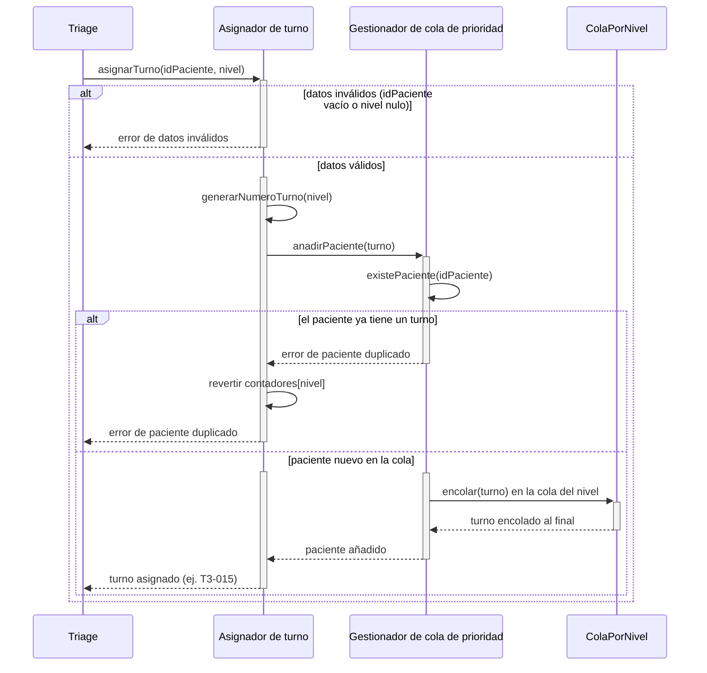
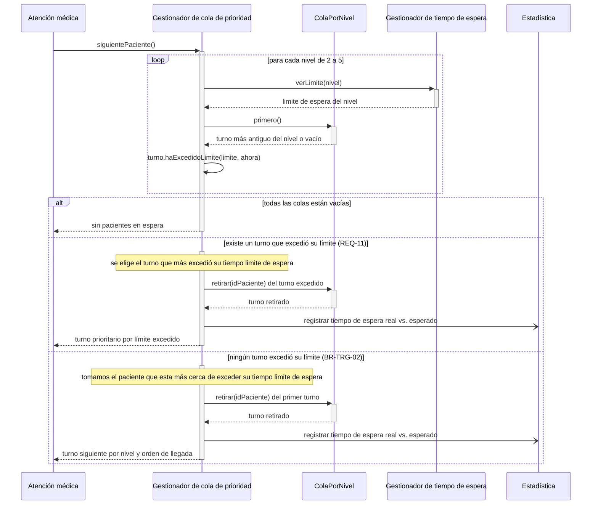
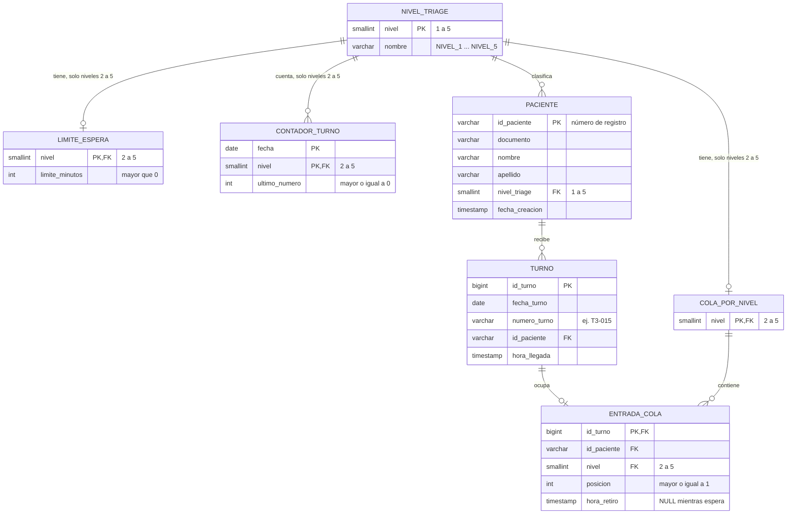

# Adres en Urgencias — Interaction & Data Design v1.0 (REQ-04 y REQ-11)

| **Team**    | Grupo 3                                                                                                                                                                                       |
|-------------|-----------------------------------------------------------------------------------------------------------------------------------------------------------------------------------------------|
| **Members** | - Bryan Gustavo Llontop Angulo (@BLlontopSec) - Diego Stevan Anacona Velez (@elDIEGO12) - Diego Ibáñez (@Dielix22) - Adrien ROHO (@hoverwars) - Sebastian Eisneider Rey Pretel (@sereypretel) |
| **Status**  | Ready for review                                                                                                                                                                              |
| **Date**    | 25/10/2026                                                                                                                                                                                    |
| **Inputs** | `docs/design/01_Architectural_and_Detailed_Design.md`, Use Cases in `docs/requirements/`, Interaction & Contracts Design v0.1 (Class 13) |

---

## 1. Behavior — Selected Use Cases

Select **two** important use cases from your own project that involve meaningful interaction between components. One of them should be the use case of your capstone requirement.

### 1.1 Añadir un paciente a la cola de espera — from requirement REQ-04

*Alcance: módulo "Gestión de turno" (Asignador de turno, Gestionador de cola de prioridad). Triage es un modulo externo a este módulo.*

| Use Case step or flow | Message(s) in the diagram | Information exchanged | Operation defined in (Deliverable 1) |
|---|---|---|---|
| Main flow, step 1: Triage entrega el resultado | `asignarTurno(idPaciente, nivel)` | Número de registro del paciente y nivel de Triage (2 a 5) | `AsignadorDeTurno.asignarTurno` (sec. 3.2, 3.4) |
| Main flow, step 2: se genera el número de turno | `generarNumeroTurno(nivel)` | Nivel → número con formato `T3-015`, contador diario por nivel | `AsignadorDeTurno.generarNumeroTurno` (privada, sec. 3.2) |
| Main flow, step 3: se posiciona al paciente en la cola | `anadirPaciente(turno)`, `encolar(turno)` | `Turno` (número, idPaciente, nivel, horaLlegada); queda al final de los turnos de su nivel (BR-TRG-02, desempate por llegada) | `GestionadorColaPrioridad.anadirPaciente`, `ColaPorNivel.encolar` |
| Exception: datos inválidos | `error de datos inválidos` | Rechazo sin generar turno ni avanzar el contador | `AsignadorDeTurno.asignarTurno`, paso 1 (sec. 3.4) |
| Exception: paciente duplicado | `error de paciente duplicado`, `revertir contadores[nivel]` | Rechazo; el Asignador deshace el incremento del contador del nivel y el turno existente queda intacto | `GestionadorColaPrioridad.anadirPaciente`, paso 4.1 (sec. 3.4) |

### 1.2 Retirar el paciente más prioritario de la cola de espera — from requirement REQ-11

*Alcance: módulo "Gestión de turno" (Gestionador de cola de prioridad, Gestionador de tiempo de espera). Atención médica y Estadística son sistemas externos al módulo.*

| Use Case step or flow | Message(s) in the diagram | Information exchanged | Operation defined in (Deliverable 1) |
|---|---|---|---|
| Main flow, step 1: Atención médica libera un cupo | `siguientePaciente()` | Sin parámetros; devuelve un `Turno` | `GestionadorColaPrioridad.siguientePaciente` |
| Main flow, step 2: se revisa el primer turno de cada nivel | `verLimite(nivel)`, `primero()`, `haExcedidoLimite(limite, ahora)` | Nivel → `Duration`; primer `Turno` del nivel; booleano | `GestionadorTiempoEspera.verLimite`, `ColaPorNivel.primero`, `Turno.haExcedidoLimite` |
| Main flow, step 3: se retira y se entrega el paciente | `retirar(idPaciente)`, `registrar tiempo de espera real vs. esperado`, respuesta a Atención médica | `Turno` retirado; tiempo de espera real y límite del nivel enviados a Estadística | `ColaPorNivel.retirar`, `GestionadorColaPrioridad.quitarPaciente` (evento a Estadística: sec. 2.2) |
| Alternative flow: un turno excedió su límite (REQ-11) | rama `existe un turno que excedió su límite` | Se elige el turno que más excedió su tiempo límite de espera; pasa antes que los demás, aunque su nivel sea menos prioritario | `GestionadorColaPrioridad.siguientePaciente` (decisión de base 2, sec. 3.2) |
| Alternative flow: ningún turno excedió su límite (BR-TRG-02) | rama `ningún turno excedió su límite`, `retirar(idPaciente)` del primer turno | Se elige el paciente más cercano a exceder su tiempo límite de espera; se retira y se entrega a Atención médica | `GestionadorColaPrioridad.siguientePaciente`, `ColaPorNivel.retirar` |
| Exception: cola vacía | `sin pacientes en espera` | Respuesta vacía a Atención médica | `GestionadorColaPrioridad.siguientePaciente` |

---

## 2. Data Design

*Alcance: datos del módulo "Gestión de turno" (Asignador de turno, Gestionador de cola de prioridad, Gestionador de tiempo de espera), necesarios para los casos de uso 1.1 (REQ-04) y 1.2 (REQ-11). Base de datos: PostgreSQL, relacional (ADR-0001).*

### 2.1 Principal information the system needs

| Information | Needed by (use cases) | Persisted? | Why (or why not) |
|---|---|---|---|
| Paciente (número de registro, documento, nombre, apellido, nivel de Triage actual e instante en que el módulo lo conoce) | 1.1, 1.2 | Si | El turno debe referirse a un paciente, y `existePaciente` necesita saber si ya tiene un turno activo. El nivel de Triage (1 a 5) se guarda en el paciente: de él dependen su cola y su prefijo de turno. Solo se copian los datos de identificación (documento, nombre, apellido) que Registro entrega; los datos clínicos y el resto de datos demográficos pertenecen a Registro y no se copian aquí. |
| Turno (número `T3-015`, paciente, hora de llegada) | 1.1, 1.2 | Si | Debe sobrevivir a un reinicio del sistema; sin él se pierde el orden de los pacientes en espera. Se conserva después de retirado para poder calcular el tiempo de espera real. |
| Contador diario de turnos por nivel | 1.1 | Si | Garantiza números únicos (CON-TRG-02) y que la secuencia no se repita tras un reinicio dentro del mismo día. Se reinicia cada día (REQ-04, Q1). |
| Nivel de Triage (niveles 1 a 5) | 1.1, 1.2 | Si | Dato de referencia, clave foránea de pacientes, colas, límites y contadores. El nivel 1 existe como nivel del paciente, pero no tiene cola, límite ni contador: no entra en el algoritmo (BR-TRG-03). |
| Cola por nivel (niveles 2 a 5) y posición de cada turno en ella | 1.1, 1.2 | Si | La posición no se puede deducir solo de la hora de llegada, porque `insertar(turno, posicion)` y `actualizarPaciente` reubican turnos. La entrada de cola conserva el nivel en el que el paciente esperó, aunque su nivel actual cambie después. |
| Instante de retiro de la cola | 1.2 | Si | Distingue a los pacientes en espera de los ya llamados y permite calcular el tiempo de espera real. |
| Tiempo límite de espera por nivel | 1.2 | Si | Es configurable (REQ-10) y debe conservarse entre reinicios. |
| Lista ordenada de la cola (`verListaOrdenada`) | Visualización de cola | No | Se recalcula a pedido a partir de las posiciones y los niveles. |
| Resultado de `haExcedidoLimite` y el siguiente paciente elegido | 1.2 | No | Se recalcula en cada llamado con la hora actual y los límites vigentes. |
| Estado interno de `GestionadorColaPrioridad` y `AsignadorDeTurno` | 1.1, 1.2 | No | Son fachadas sin estado propio: toda su información está en las tablas anteriores. |
| Evento hacia Estadística (tiempo de espera real vs. esperado) | 1.2 | No | Es un mensaje asíncrono pero, esta afuera del alcance (Estadística). |
| Pantallas de espera | — | No | Fuera del alcance (Visualización de cola). |

> Aqui, suponemos que los numeros de turnos se reinician cada dia, pero se queda como una pregunta abierta como lo dijimos en el documento `REQ-04.md`

### 2.2 Data model

Se elige el modelo **relacional** porque el stack ya fijó PostgreSQL (ADR-0001) y las reglas del módulo se apoyan en integridad referencial, unicidad y transacciones: no duplicar un paciente en espera, no repetir una posición dentro de un nivel y consumir un número de turno solo si el turno se crea.

El **nivel de Triage (1 a 5) pertenece al paciente** (`paciente.nivel_triage`); `turno` ya no lo repite. Los niveles 2 a 5 son los únicos con cola, límite y contador (BR-TRG-03, REQ-10): `cola_por_nivel`, `limite_espera` y `contador_turno` llevan `CHECK (nivel BETWEEN 2 AND 5)`.

Cada clase del diseño (Documento 01, sec. 3.2) tiene una representación: `Turno`, `ColaPorNivel`, `NivelTriage` y los datos de `GestionadorTiempoEspera` y de `AsignadorDeTurno.contadores` son tablas propias. `GestionadorColaPrioridad` es una fachada y no tiene tabla: opera sobre `cola_por_nivel` y `entrada_cola`. La entidad `Paciente` se añade en este módulo.

*(`TURNO` tiene además `UNIQUE (fecha_turno, numero_turno)` y `UNIQUE (id_turno, id_paciente)`. `ENTRADA_COLA` referencia `(id_turno, id_paciente)` en `TURNO` y `nivel` en `COLA_POR_NIVEL`. Un turno retirado conserva su fila en `ENTRADA_COLA` con `hora_retiro` rellena y el nivel en el que esperó.)*

| Entity / document type | Meaning in the system | Identifier | Constraints (required, unique, allowed values) |
|---|---|---|---|
| `nivel_triage` (`NivelTriage`) | Los cinco niveles de Triage. El nivel 1 existe solo como nivel del paciente. | `nivel` | `nivel` entre 1 y 5. `nombre` obligatorio y único. |
| `limite_espera` (`GestionadorTiempoEspera.limites`) | Tiempo límite de espera de un nivel (REQ-10, REQ-11). | `nivel` (también FK a `nivel_triage`) | `nivel` entre 2 y 5 (el nivel 1 se atiende de inmediato, REQ-10). Exactamente una fila por nivel. `limite_minutos` obligatorio y mayor que 0. |
| `paciente` (entidad Paciente) | Paciente que entra en el módulo "Turno". Guarda la identidad dada por Registro (número de registro, documento, nombre, apellido) y el nivel de Triage vigente (dado por Triage); no guarda otros datos personales ni clínicos. | `id_paciente` (número de registro) | `id_paciente` obligatorio, no vacío, único. `documento`, `nombre` y `apellido` obligatorios y no vacíos (`documento` no es único: ver sec. 5). `nivel_triage` obligatorio, FK a `nivel_triage` (1 a 5), es el nivel vigente del paciente. `fecha_creacion` obligatoria. |
| `contador_turno` (`AsignadorDeTurno.contadores`) | Último número emitido para un nivel en un día. | (`fecha`, `nivel`) | `nivel` entre 2 y 5. `ultimo_numero` obligatorio y mayor o igual a 0. Solo crece (ver 2.4). |
| `turno` (`Turno`) | Turno asignado a un paciente en una visita. | `id_turno` | `fecha_turno`, `numero_turno`, `id_paciente` y `hora_llegada` obligatorios. (`fecha_turno`, `numero_turno`) único. FK a `paciente`. El nivel se lee de `paciente.nivel_triage`; el prefijo del número (`T3`) es el nivel en el momento de la emisión. |
| `cola_por_nivel` (`ColaPorNivel`) | La cola FIFO de un nivel. | `nivel` (también FK a `nivel_triage`) | `nivel` entre 2 y 5. Exactamente una cola por nivel con cola. |
| `entrada_cola` (`ColaPorNivel.turnos`) | Presencia de un turno en la cola de su nivel, con su posición y su retiro. | `id_turno` (también FK a `turno`) | `posicion` obligatoria y mayor o igual a 1. (`nivel`, `posicion`) único entre las entradas con `hora_retiro` vacía, es decir en espera. `id_paciente` único entre las entradas en espera. `(id_turno, id_paciente)` debe coincidir con el turno. `nivel` es FK a `cola_por_nivel` y es el nivel en el que el turno esperó. `hora_retiro`, si existe, es mayor o igual a `hora_llegada`. |

### 2.3 Data Ownership

| Information | Authoritative owner (component responsible for maintaining it) | Consumed by (uses it without owning it) | Access through |
|---|---|---|---|
| `paciente` (incluido su `nivel_triage`) | Registro | Gestionador de cola de prioridad (verifica duplicados y lee el nivel) | `AsignadorDeTurno.asignarTurno`, `actualizarNivelTriage`; la cola consulta con `existePaciente` |
| `turno` | Asignador de turno | Gestionador de cola de prioridad, Estadística (a través del evento) | `AsignadorDeTurno.asignarTurno`, `actualizarNivelTriage`; la cola lo recibe como parámetro |
| `contador_turno` | Asignador de turno | Nadie más | Operaciones internas de `AsignadorDeTurno` (`generarNumeroTurno`) |
| `cola_por_nivel` y `entrada_cola` | Gestionador de cola de prioridad | Visualización de cola (lista ordenada), Atención médica (siguiente paciente) | `anadirPaciente`, `actualizarPaciente`, `quitarPaciente`, `siguientePaciente`, `verListaOrdenada`, `existePaciente` |
| `limite_espera` | Gestionador de tiempo de espera | Gestionador de cola de prioridad | `verLimite`, `cambiarLimite` |
| `nivel_triage` | Gestionador de tiempo de espera | Todos los demás componentes del módulo | Enumeración `NivelTriage` (datos de referencia de solo lectura; incluye el nivel 1) |

*(`GestionadorColaPrioridad` no escribe directamente en `turno` ni en `paciente`: solo lee los datos que recibe y gestiona `entrada_cola`. El cambio de nivel de un paciente pasa por `AsignadorDeTurno.actualizarNivelTriage`, que actualiza `paciente.nivel_triage` y pide a la cola que reubique su entrada.)*

### 2.4 Business rules and invariants enforced in data

| Business rule or invariant | Where it is enforced (component logic / data constraint / both) | How |
|---|---|---|
| El nivel de Triage va de 1 a 5, pero solo los niveles 2 a 5 tienen cola, límite y contador; el nivel 1 no entra en la cola (BR-TRG-03) | Both | `paciente.nivel_triage` es FK a `nivel_triage` (1 a 5). `cola_por_nivel`, `limite_espera`, `contador_turno` y `entrada_cola` llevan `CHECK (nivel BETWEEN 2 AND 5)`, así que un paciente de nivel 1 no puede tener entrada de cola. El Asignador no crea turno para el nivel 1 y rechaza el nivel nulo o fuera de rango (sec. 3.4 del Documento 01, paso 1). |
| Un paciente no puede tener dos turnos en espera (`existePaciente`) | Both | Índice único parcial sobre `entrada_cola (id_paciente) WHERE hora_retiro IS NULL`; la lógica comprueba antes con `existePaciente` y traduce la violación en "error de paciente duplicado". |
| Orden de llegada dentro de un nivel (BR-TRG-02) | Component logic | `encolar` asigna `posicion = máxima del nivel + 1`; el desempate lo da la posición. |
| Posición única por nivel entre los turnos en espera | Data constraint | Índice único parcial sobre `entrada_cola (nivel, posicion) WHERE hora_retiro IS NULL`. |
| La entrada de cola coincide con el turno y con el nivel vigente del paciente mientras espera | Both | Clave foránea compuesta `(id_turno, id_paciente)` hacia `turno`. Para el nivel, un trigger comprueba que `entrada_cola.nivel = paciente.nivel_triage` mientras `hora_retiro IS NULL`; `actualizarNivelTriage` cambia ambos en una misma transacción. Las entradas ya retiradas conservan el nivel en el que esperaron (necesario para el tiempo de espera real vs. esperado). |
| El número de turno no se repite en un día y no se puede modificar (CON-TRG-02) | Both | `UNIQUE (fecha_turno, numero_turno)`; el único camino de escritura es `AsignadorDeTurno`. |
| El contador diario solo avanza y el número solo se consume si el turno se crea | Both | `CHECK (ultimo_numero >= 0)` y una única transacción que incrementa el contador e inserta `turno` y `entrada_cola`; ante un duplicado se hace `ROLLBACK`, lo que sustituye al "revertir `contadores[nivel]`" (punto a iterar 1 de la sec. 1.1). |
| Una cola por nivel y un límite por nivel | Data constraint | Clave primaria `nivel` en `cola_por_nivel` y en `limite_espera`. |
| El tiempo límite de espera es positivo (REQ-10) | Both | `CHECK (limite_minutos > 0)`; `cambiarLimite` valida el valor. |
| El retiro devuelve el turno más antiguo del nivel elegido (REQ-11, BR-TRG-02) | Component logic | `siguientePaciente` compara el primer turno de cada nivel con su límite; el retiro marca `hora_retiro` en la misma transacción. |
| `hora_retiro` no es anterior a `hora_llegada` | Data constraint | Trigger sobre `entrada_cola`, porque un `CHECK` de PostgreSQL no puede comparar columnas de dos tablas. |

> Aqui, suponemos que los numeros de turnos se reinician cada dia, pero se queda como una pregunta abierta como lo dijimos en el documento `REQ-04.md`

---

## 3. Interface Contract

**Interaction chosen** (from diagram 1.1, message `asignarTurno(idPaciente, nivel)`):

> Triage entrega a `AsignadorDeTurno` el resultado de la clasificación de un paciente y recibe a cambio el turno asignado, o un error. Es la interacción central de REQ-04 y la única que escribe en `contador_turno`, `turno` y `entrada_cola`.

|Element|Specification|
|---|---|
|**Operation and purpose**|`AsignadorDeTurno.asignarTurno(idPaciente, nivel)`: genera el número de turno del paciente y lo deja al final de la cola de su nivel.|
|**Input** (parameters and types)|`idPaciente`: texto, número de registro del paciente (no vacío). `nivel`: `NivelTriage` con valor entre NIVEL_2 y NIVEL_5 (nivel de Triage del paciente).|
|**Output** (successful result and data structure)|Un `Turno` con: `numeroTurno` (formato `T<nivel>-<NNN>`, ej. `T3-015`), `idPaciente`, `nivel`, `horaLlegada`.|
|**Preconditions** (what the caller must satisfy before invoking)|1. `idPaciente` no es vacío. 2. `nivel` no es nulo y está entre NIVEL_2 y NIVEL_5. 3. El paciente no tiene un turno en espera (el Asignador lo verifica a través de `GestionadorColaPrioridad.existePaciente`; si no se cumple, es un fallo definido, no un comportamiento indefinido).|
|**Postconditions** (what is guaranteed on successful completion)|1. Existe una fila nueva en `turno` con un `numero_turno` que no se repite ese día (CON-TRG-02). 2. `contador_turno (fecha, nivel)` avanzó en exactamente 1. 3. Existe una fila nueva en `entrada_cola` con `hora_retiro` vacía y `posicion` = (máxima posición en espera del nivel) + 1, es decir, el paciente quedó al final de su nivel (BR-TRG-02). 4. Todo lo anterior ocurrió en una sola transacción: o están los tres cambios o ninguno.|
|**Failure outcomes** (each failure, and what state is left after it)|**DATOS_INVALIDOS** (`idPaciente` vacío, `nivel` nulo o fuera de 2 a 5): no se genera número, no se toca el contador, no se escribe nada. **PACIENTE_DUPLICADO** (el paciente ya tiene un turno en espera): `ROLLBACK`; el contador queda como estaba, no se crea turno ni entrada de cola y el turno existente queda intacto. En ambos casos el estado persistido es idéntico al de antes de la llamada.|
|**Invariants and side effects** (what must stay true, what may change)|Invariantes: un paciente tiene como máximo una entrada en espera; (`nivel`, `posicion`) es único entre los turnos en espera; el contador diario solo crece y un número solo se consume si el turno se crea; `numero_turno` no se modifica una vez emitido. Efectos secundarios: escribe en `contador_turno`, `turno` y `entrada_cola`. No notifica a Estadística (eso ocurre solo al retirar, caso 1.2).|

**Testable examples**

|Case|Before|Request|Expected|
|---|---|---|---|
|Éxito|`contador_turno` (hoy, 3) = 14; nivel 3 tiene 2 pacientes en espera; el paciente `P-1001` no tiene turno|`asignarTurno("P-1001", 3)`|Devuelve `T3-015`; contador = 15; `entrada_cola` con `posicion = 3` y `hora_retiro` vacía|
|Paciente duplicado|`P-1001` ya espera con `T3-015`; contador nivel 3 = 15|`asignarTurno("P-1001", 3)`|Error `PACIENTE_DUPLICADO`; contador sigue en 15; no hay segundo turno; `T3-015` intacto|
|Datos inválidos (id vacío)|Cualquier estado|`asignarTurno("", 3)`|Error `DATOS_INVALIDOS`; ningún cambio de estado|
|Datos inválidos (nivel fuera de rango)|Cualquier estado|`asignarTurno("P-2002", 6)`|Error `DATOS_INVALIDOS`; ningún cambio de estado|
|Primer turno del día|No hay fila en `contador_turno` para hoy y nivel 4|`asignarTurno("P-3003", 4)`|Devuelve `T4-001` _(supuesto: la numeración reinicia cada día y arranca en 001; ver sec. 2.1 y 2.4, pregunta abierta en sec. 5)_|

---

## 4. Cross-Consistency & Changes to Deliverable 1

|Check|Result|
|---|---|
|Every participant in a sequence diagram is an actor, a component, a class or an external system from Deliverable 1|**Cumple.** Triage, Atención médica y Estadística son sistemas externos (Documento 01, sec. 2.1). `AsignadorDeTurno`, `GestionadorColaPrioridad`, `GestionadorTiempoEspera` y `ColaPorNivel` son clases de la sec. 3.2. `Registro` es externo pero no aparece en los diagramas: el caso 1.1 solo recibe `idPaciente` (ver Cambio 7).|
|Every message corresponds to a capability, operation or contract|**Cumple.** `asignarTurno`, `generarNumeroTurno`, `anadirPaciente`, `existePaciente`, `encolar`, `siguientePaciente`, `verLimite`, `primero`, `retirar` y `haExcedidoLimite` existen en el diagrama de clases (sec. 3.2). El evento a Estadística coincide con la flecha de la sec. 2.2. Excepción: `revertir contadores[nivel]` del caso 1.1 y de la sec. 3.4 no coincide con el modelo de datos, que usa una transacción (Cambio 6).|
|Every entity or document type is reflected in the class diagrams, or the reason it is not is stated|**Parcial → se resuelve con los Cambios 1 a 5.** Tienen clase: `turno`, `cola_por_nivel`, `limite_espera`, `nivel_triage` y `contador_turno`. No la tienen todavía: `paciente` (no existe en la sec. 3.2) y el nivel 1 (el enum solo tiene NIVEL_2 a NIVEL_5). `entrada_cola` es la representación persistente de `ColaPorNivel.turnos`.|
|Every persisted information element has exactly one authoritative owner|**Parcial.** Cada elemento tiene un único dueño en la sec. 2.3, salvo `paciente`: se declara a Registro como dueño, pero `nivel_triage` lo escribe `AsignadorDeTurno.actualizarNivelTriage`, y Registro es externo.|
|The contract agrees with the sequence diagram and with the data model (same behavior in all three views)|**Cumple, con el Cambio 6.** El contrato de `asignarTurno` (sec. 3) sigue el modelo de datos (una transacción y `ROLLBACK`, índices únicos de la sec. 2.4) y el flujo del diagrama 1.1. Al aplicar el Cambio 6, el diagrama y la sec. 3.4 del Documento 01 quedan alineados con ambos.|

**Changes made to Deliverable 1 because of this deliverable**

> Al concretar el comportamiento y los datos, el Documento 01 necesita los siguientes ajustes:
> 
> 1. **Sec. 3.2 y 3.3, nueva clase `Paciente`** (`idPaciente`, `documento`, `nombre`, `apellido`, `nivelTriage`, `fechaCreacion`). Motivo: el modelo de datos la necesita para verificar duplicados (`existePaciente`) y para guardar el nivel vigente. Pertenece al componente _Asignador de turno_.
> 2. **Sec. 3.2 y 3.3, `NivelTriage`:** añadir `NIVEL_1` (sin cola, límite ni contador) y cambiar "los cuatro niveles" por "los cinco niveles, de los cuales solo 2 a 5 tienen cola". Motivo: `paciente.nivel_triage` va de 1 a 5 (BR-TRG-03).
> 3. **Sec. 3.2, `Turno`:** quitar `nivelTriage` como atributo propio (el nivel vigente se lee de `Paciente`) y añadir `fechaTurno`. `cambiarNivel` pasa a ser `actualizarNivelTriage` sobre el paciente. Motivo: evitar dos fuentes del mismo dato.
> 4. **Sec. 3.2, `AsignadorDeTurno.contadores`:** deja de ser un `Map<NivelTriage, int>` en memoria y pasa a ser el dato persistente `contador_turno`, con clave (`fecha`, `nivel`). Motivo: la numeración debe sobrevivir a un reinicio y reiniciarse cada día.
> 5. **Sec. 3.2, `ColaPorNivel.turnos`:** se persiste como `entrada_cola`, con `posicion` y `horaRetiro`. `retirar` marca `horaRetiro` en lugar de borrar la entrada. Motivo: Estadística necesita el tiempo de espera real.
> 6. **Sec. 3.4 y hallazgo de la sec. 4:** sustituir "revertir `contadores[nivel]`" por "la operación es una única transacción; si el paciente está duplicado se hace `ROLLBACK` y el contador no avanza". El hallazgo de la sec. 4 pasa de "cambiaría" a "cambiado". En el diagrama 1.1, cambiar `revertir contadores[nivel]` por una nota de rollback de la transacción.
> 7. **Sec. 2.2, tabla de componentes:** como el módulo guarda `documento`, `nombre` y `apellido`, _Asignador de turno_ requiere de Registro la capacidad "obtener los datos de identificación de un paciente".

---

## 5. Open Questions

> Anything unresolved about behavior or data. List it here instead of guessing.

---

## 6. Optional — AI-Assisted Design Reflection

> One design recommendation generated by AI that the team accepted, modified or rejected, and why.

---

## 7. Consistency Checklist

- [ ] Two use cases from the project, each traceable to a Use Case written in the requirements.
- [ ] Each sequence diagram shows the main flow and at least one alternative or exception flow.
- [ ] No business behavior is invented: anything unspecified is marked as an assumption or Open Question.
- [ ] Section 2.1 explains what is NOT persisted as well as what is.
- [ ] The data model has identifiers, relationships and constraints, not only boxes.
- [ ] Every piece of principal information has one authoritative owner, and consumers are listed (Section 2.3).
- [ ] The contract defines input, output, preconditions, postconditions and failure outcomes.
- [ ] Sequence, data model and contract describe the same behavior.
- [ ] Diagrams render correctly on GitHub (or the exported images are embedded).