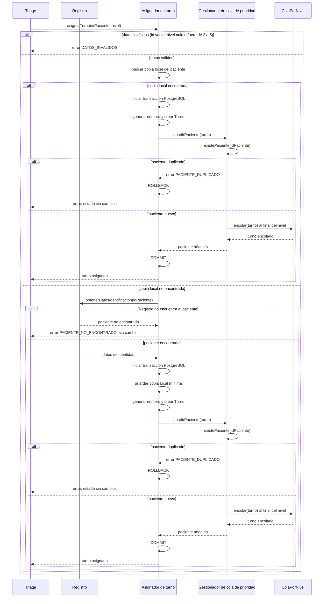
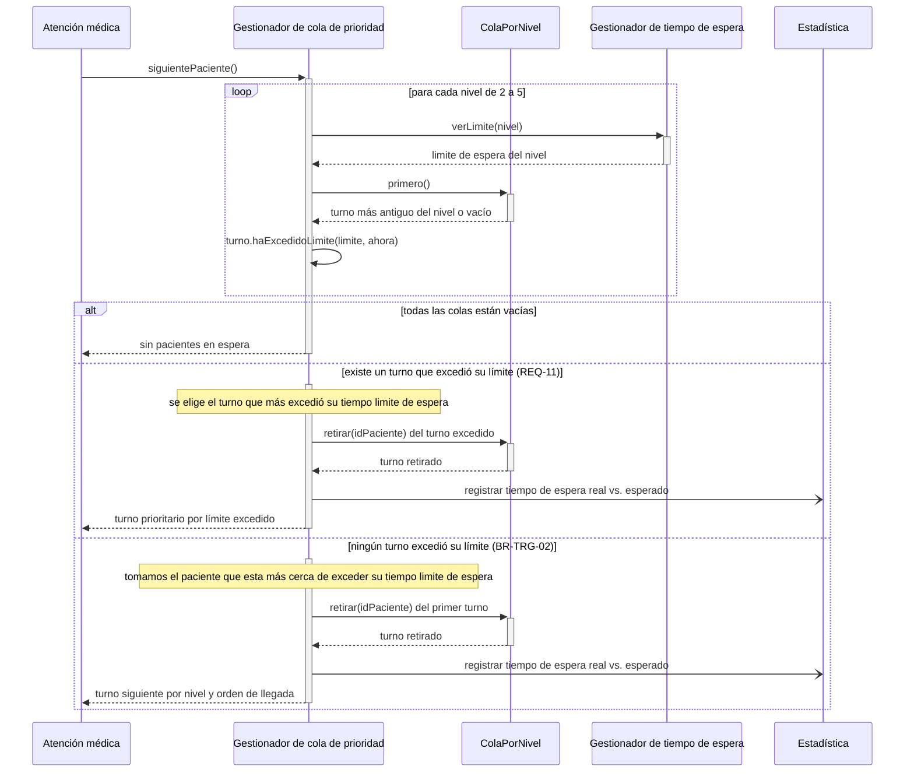
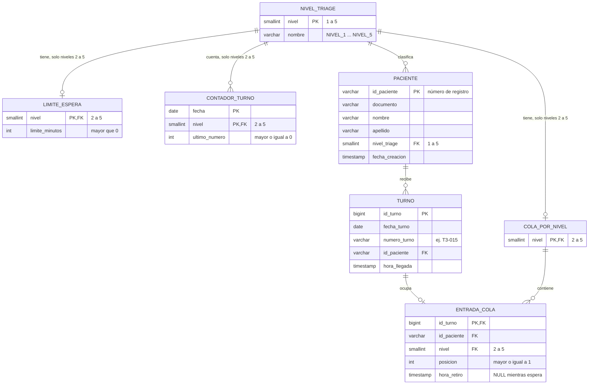

# Adres en Urgencias — Interaction & Data Design v1.0 (REQ-04 y REQ-11)

| **Team**    | Grupo 3                                                                                                                                                                                       |
|-------------|-----------------------------------------------------------------------------------------------------------------------------------------------------------------------------------------------|
| **Members** | - Bryan Gustavo Llontop Angulo (@BLlontopSec) - Diego Stevan Anacona Velez (@elDIEGO12) - Diego Ibáñez (@Dielix22) - Adrien ROHO (@hoverwars) - Sebastian Eisneider Rey Pretel (@sereypretel) |
| **Status**  | Revised; REQ-11 tie-break and hospital time zone pending                                                                                                                                                                              |
| **Date**    | 25/10/2026                                                                                                                                                                                    |
| **Inputs** | `docs/design/01_Architectural_and_Detailed_Design.md`, Use Cases in `docs/requirements/`, Interaction & Contracts Design v0.1 (Class 13) |

---

## 1. Behavior — Selected Use Cases

Select **two** important use cases from your own project that involve meaningful interaction between components. One of them should be the use case of your capstone requirement.

### 1.1 Añadir un paciente a la cola de espera — from requirement REQ-04

*Alcance: módulo "Gestión de turno" (Asignador de turno, Gestionador de cola de prioridad). Triage es un modulo externo a este módulo.*

| Use Case step or flow | Message(s) in the diagram | Information exchanged | Operation defined in (Deliverable 1) |
|---|---|---|---|
| Main flow, step 1: Triage entrega el resultado | asignarTurno(idPaciente, nivel); consulta de identidad a Registro si falta copia local | Número de registro, nivel de Triage y datos mínimos de identidad cuando se consultan | AsignadorDeTurno.asignarTurno y Registro.obtenerDatosIdentificacion |
| Main flow, step 2: se genera el número de turno | `generarNumeroTurno(nivel)` | Nivel → número con formato `T3-015`, contador diario por nivel | `AsignadorDeTurno.generarNumeroTurno` (privada, sec. 3.2) |
| Main flow, step 3: se posiciona al paciente en la cola | `anadirPaciente(turno)`, `encolar(turno)` | `Turno` (número, idPaciente, nivel, horaLlegada); queda al final de los turnos de su nivel (BR-TRG-02, desempate por llegada) | `GestionadorColaPrioridad.anadirPaciente`, `ColaPorNivel.encolar` |
| Exception: Registro no encuentra al paciente | PACIENTE_NO_ENCONTRADO | No se crea/actualiza copia local y no cambian contador, turno ni cola | AsignadorDeTurno consulta Registro (capacidad añadida en Documento 01) |
| Exception: datos inválidos | `error de datos inválidos` | Rechazo sin generar turno ni avanzar el contador | `AsignadorDeTurno.asignarTurno`, paso 1 (sec. 3.4) |
| Exception: paciente duplicado | PACIENTE_DUPLICADO, ROLLBACK | Rechazo; contador, turno y entrada quedan sin cambios y el turno activo permanece intacto | GestionadorColaPrioridad.anadirPaciente (sec. 3.4) |

### 1.2 Retirar el paciente más prioritario de la cola de espera — from requirement REQ-11

*Alcance: módulo "Gestión de turno" (Gestionador de cola de prioridad, Gestionador de tiempo de espera). Atención médica y Estadística son sistemas externos al módulo.*

| Use Case step or flow | Message(s) in the diagram | Information exchanged | Operation defined in (Deliverable 1) |
|---|---|---|---|
| Main flow, step 1: Atención médica libera un cupo | `siguientePaciente()` | Sin parámetros; devuelve un `Turno` | `GestionadorColaPrioridad.siguientePaciente` |
| Main flow, step 2: se revisa el primer turno de cada nivel | `verLimite(nivel)`, `primero()`, `haExcedidoLimite(limite, ahora)` | Nivel → `Duration`; primer `Turno` del nivel; booleano | `GestionadorTiempoEspera.verLimite`, `ColaPorNivel.primero`, `Turno.haExcedidoLimite` |
| Main flow, step 3: se retira y se entrega el paciente | `retirar(idPaciente)`, `registrar tiempo de espera real vs. esperado`, respuesta a Atención médica | `Turno` retirado; tiempo de espera real y límite del nivel enviados a Estadística | `ColaPorNivel.retirar`, `GestionadorColaPrioridad.quitarPaciente` (evento a Estadística: sec. 2.2) |
| Alternative flow: un turno excedió su límite (REQ-11) | rama `existe un turno que excedió su límite` | Se elige el turno que más excedió su tiempo límite de espera; pasa antes que los demás, aunque su nivel sea menos prioritario | `GestionadorColaPrioridad.siguientePaciente` (decisión de base 2, sec. 3.2) |
| Alternative flow: ningún turno excedió su límite (BR-TRG-02) | rama `ningún turno excedió su límite`, `retirar(idPaciente)` del primer turno | Se elige el paciente más cercano a exceder su tiempo límite de espera; se retira y se entrega a Atención médica | `GestionadorColaPrioridad.siguientePaciente`, `ColaPorNivel.retirar` |
| Exception: cola vacía | `sin pacientes en espera` | Respuesta vacía a Atención médica | `GestionadorColaPrioridad.siguientePaciente` |

---

## 2. Data Design

*Alcance: datos del módulo "Gestión de turno" (Asignador de turno, Gestionador de cola de prioridad, Gestionador de tiempo de espera), necesarios para los casos de uso 1.1 (REQ-04) y 1.2 (REQ-11). Base de datos: PostgreSQL, relacional (ADR-0001).*

### 2.1 Principal information the system needs

| Information | Needed by (use cases) | Persisted? | Why (or why not) |
|---|---|---|---|
| Paciente (número de registro, documento, nombre, apellido, nivel de Triage actual e instante en que el módulo lo conoce) | 1.1, 1.2 | Si | El turno debe referirse a un paciente, y `existePaciente` necesita saber si ya tiene un turno activo. El nivel de Triage (1 a 5) se guarda en la copia local mínima del paciente: de él dependen su cola y su prefijo de turno. Solo se copian los datos de identificación (documento, nombre, apellido) que Registro entrega; los datos clínicos y el resto de datos demográficos pertenecen a Registro y no se copian aquí. |
| Turno (número `T3-015`, paciente, hora de llegada) | 1.1, 1.2 | Si | Debe sobrevivir a un reinicio del sistema; sin él se pierde el orden de los pacientes en espera. Se conserva después de retirado para poder calcular el tiempo de espera real. |
| Contador diario de turnos por nivel | 1.1 | Si | Decisión acordada: reinicio diario y comienzo en 001 por nivel; falta documentar la zona horaria aplicable. |
| Nivel de Triage (niveles 1 a 5) | 1.1, 1.2 | Si | Dato de referencia, clave foránea de pacientes, colas, límites y contadores. El nivel 1 existe como nivel del paciente, pero no tiene cola, límite ni contador: no entra en el algoritmo (BR-TRG-03). |
| Cola por nivel (niveles 2 a 5) y posición de cada turno en ella | 1.1, 1.2 | Si | La posición no se puede deducir solo de la hora de llegada, porque `insertar(turno, posicion)` y `actualizarPaciente` reubican turnos. La entrada de cola conserva el nivel en el que el paciente esperó, aunque su nivel actual cambie después. |
| Instante de retiro de la cola | 1.2 | Si | Distingue a los pacientes en espera de los ya llamados y permite calcular el tiempo de espera real. |
| Tiempo límite de espera por nivel | 1.2 | Si | Es configurable (REQ-10) y debe conservarse entre reinicios. |
| Lista ordenada de la cola (`verListaOrdenada`) | Visualización de cola | No | Se recalcula a pedido a partir de las posiciones y los niveles. |
| Resultado de `haExcedidoLimite` y el siguiente paciente elegido | 1.2 | No | Se recalcula en cada llamado con la hora actual y los límites vigentes. |
| Estado interno de `GestionadorColaPrioridad` y `AsignadorDeTurno` | 1.1, 1.2 | No | Son fachadas sin estado propio: toda su información está en las tablas anteriores. |
| Evento hacia Estadística (tiempo de espera real vs. esperado) | 1.2 | No | Es un mensaje asíncrono pero, esta afuera del alcance (Estadística). |
| Pantallas de espera | — | No | Fuera del alcance (Visualización de cola). |

> Aqui, suponemos que los numeros de turnos se reinician cada dia, pero se queda como una pregunta abierta como lo dijimos en el documento `REQ-04.md`

### 2.2 Data model

Se elige el modelo **relacional** porque el stack ya fijó PostgreSQL (ADR-0001) y las reglas del módulo se apoyan en integridad referencial, unicidad y transacciones: no duplicar un paciente en espera, no repetir una posición dentro de un nivel y consumir un número de turno solo si el turno se crea.

El **nivel de Triage (1 a 5) pertenece al paciente** (`paciente.nivel_triage`); `turno` ya no lo repite. Los niveles 2 a 5 son los únicos con cola, límite y contador (BR-TRG-03, REQ-10): `cola_por_nivel`, `limite_espera` y `contador_turno` llevan `CHECK (nivel BETWEEN 2 AND 5)`.

Cada clase del diseño (Documento 01, sec. 3.2) tiene una representación: `Turno`, `ColaPorNivel`, `NivelTriage` y los datos de `GestionadorTiempoEspera` y de `AsignadorDeTurno.contadores` son tablas propias. `GestionadorColaPrioridad` es una fachada y no tiene tabla: opera sobre `cola_por_nivel` y `entrada_cola`. La entidad `Paciente` se añade en este módulo.

*(`TURNO` tiene además `UNIQUE (fecha_turno, numero_turno)` y `UNIQUE (id_turno, id_paciente)`. `ENTRADA_COLA` referencia `(id_turno, id_paciente)` en `TURNO` y `nivel` en `COLA_POR_NIVEL`. Un turno retirado conserva su fila en `ENTRADA_COLA` con `hora_retiro` rellena y el nivel en el que esperó.)*

| Entity / document type | Meaning in the system | Identifier | Constraints (required, unique, allowed values) |
|---|---|---|---|
| `nivel_triage` (`NivelTriage`) | Los cinco niveles de Triage. El nivel 1 existe solo como nivel del paciente. | `nivel` | `nivel` entre 1 y 5. `nombre` obligatorio y único. |
| `limite_espera` (`GestionadorTiempoEspera.limites`) | Tiempo límite de espera de un nivel (REQ-10, REQ-11). | `nivel` (también FK a `nivel_triage`) | `nivel` entre 2 y 5 (el nivel 1 se atiende de inmediato, REQ-10). Exactamente una fila por nivel. `limite_minutos` obligatorio y mayor que 0. |
| paciente (copia local de Paciente) | Proyección mínima para asociar turnos; Registro sigue siendo fuente autoritativa de identidad. | id_paciente (número de registro) | Identidad recibida de Registro; nivel de Triage válido y fecha de creación obligatorios. |
| `contador_turno` (`AsignadorDeTurno.contadores`) | Último número emitido para un nivel en un día. | (`fecha`, `nivel`) | `nivel` entre 2 y 5. `ultimo_numero` obligatorio y mayor o igual a 0. Solo crece (ver 2.4). |
| `turno` (`Turno`) | Turno asignado a un paciente en una visita. | `id_turno` | `fecha_turno`, `numero_turno`, `id_paciente` y `hora_llegada` obligatorios. (`fecha_turno`, `numero_turno`) único. FK a `paciente`. El nivel se lee de `paciente.nivel_triage`; el prefijo del número (`T3`) es el nivel en el momento de la emisión. |
| `cola_por_nivel` (`ColaPorNivel`) | La cola FIFO de un nivel. | `nivel` (también FK a `nivel_triage`) | `nivel` entre 2 y 5. Exactamente una cola por nivel con cola. |
| `entrada_cola` (`ColaPorNivel.turnos`) | Presencia de un turno en la cola de su nivel, con su posición y su retiro. | `id_turno` (también FK a `turno`) | `posicion` obligatoria y mayor o igual a 1. (`nivel`, `posicion`) único entre las entradas con `hora_retiro` vacía, es decir en espera. `id_paciente` único entre las entradas en espera. `(id_turno, id_paciente)` debe coincidir con el turno. `nivel` es FK a `cola_por_nivel` y es el nivel en el que el turno esperó. `hora_retiro`, si existe, es mayor o igual a `hora_llegada`. |

### 2.3 Data Ownership

| Information | Authoritative owner (component responsible for maintaining it) | Consumed by (uses it without owning it) | Access through |
|---|---|---|---|
| Datos maestros de identidad del paciente | Registro | Asignador de turno | obtenerDatosIdentificacion; Registro conserva autoridad. |
| Copia local mínima de identidad | Asignador de turno como proyección local; Registro mantiene autoridad | Gestionador de cola de prioridad | Consulta/actualización desde Registro y uso en asignarTurno. |
| Nivel de Triage vigente | Triage es autoridad de clasificación; Asignador conserva el valor recibido en su copia local | Gestionador de cola de prioridad y Asignador de turno | Resultado de Triage; actualizarNivelTriage. |
| `turno` | Asignador de turno | Gestionador de cola de prioridad, Estadística (a través del evento) | `AsignadorDeTurno.asignarTurno`, `actualizarNivelTriage`; la cola lo recibe como parámetro |
| `contador_turno` | Asignador de turno | Nadie más | Operaciones internas de `AsignadorDeTurno` (`generarNumeroTurno`) |
| `cola_por_nivel` y `entrada_cola` | Gestionador de cola de prioridad | Visualización de cola (lista ordenada), Atención médica (siguiente paciente) | `anadirPaciente`, `actualizarPaciente`, `quitarPaciente`, `siguientePaciente`, `verListaOrdenada`, `existePaciente` |
| `limite_espera` | Gestionador de tiempo de espera | Gestionador de cola de prioridad | `verLimite`, `cambiarLimite` |
| `nivel_triage` | Gestionador de tiempo de espera | Todos los demás componentes del módulo | Enumeración `NivelTriage` (datos de referencia de solo lectura; incluye el nivel 1) |

*(`GestionadorColaPrioridad` no escribe directamente en `turno` ni en `paciente`: solo lee los datos que recibe y gestiona `entrada_cola`. El cambio de nivel de un paciente pasa por `AsignadorDeTurno.actualizarNivelTriage`, que actualiza `paciente.nivel_triage` y pide a la cola que reubique su entrada.)*

### 2.4 Business rules and invariants enforced in data

| Business rule or invariant | Where it is enforced (component logic / data constraint / both) | How |
|---|---|---|
| El nivel de Triage va de 1 a 5, pero solo los niveles 2 a 5 tienen cola, límite y contador; el nivel 1 no entra en la cola (BR-TRG-03) | Both | `paciente.nivel_triage` es FK a `nivel_triage` (1 a 5). `cola_por_nivel`, `limite_espera`, `contador_turno` y `entrada_cola` llevan `CHECK (nivel BETWEEN 2 AND 5)`, así que un paciente de nivel 1 no puede tener entrada de cola. El Asignador solo crea turnos para niveles 2 a 5 y rechaza nivel nulo, nivel 1 o fuera de rango (sec. 3.4 del Documento 01, paso 1). |
| Un paciente no puede tener dos turnos en espera (`existePaciente`) | Both | Índice único parcial sobre `entrada_cola (id_paciente) WHERE hora_retiro IS NULL`; la lógica comprueba antes con `existePaciente` y traduce la violación en "error de paciente duplicado". |
| Orden de llegada dentro de un nivel (BR-TRG-02) | Component logic | `encolar` asigna `posicion = máxima del nivel + 1`; el desempate lo da la posición. |
| Posición única por nivel entre los turnos en espera | Data constraint | Índice único parcial sobre `entrada_cola (nivel, posicion) WHERE hora_retiro IS NULL`. |
| La entrada de cola coincide con el turno y con el nivel vigente del paciente mientras espera | Both | Clave foránea compuesta `(id_turno, id_paciente)` hacia `turno`. Para el nivel, un trigger comprueba que `entrada_cola.nivel = paciente.nivel_triage` mientras `hora_retiro IS NULL`; `actualizarNivelTriage` cambia ambos en una misma transacción. Las entradas ya retiradas conservan el nivel en el que esperaron (necesario para el tiempo de espera real vs. esperado). |
| El número de turno no se repite en un día y no se puede modificar (CON-TRG-02) | Both | `UNIQUE (fecha_turno, numero_turno)`; el único camino de escritura es `AsignadorDeTurno`. |
| El contador diario solo avanza y el número solo se consume si el turno se crea | Both | `CHECK (ultimo_numero >= 0)` y una única transacción PostgreSQL que incluye la copia local cuando aplica, incrementa el contador e inserta `turno` y `entrada_cola`; ante un duplicado se hace `ROLLBACK`, lo que sustituye al "revertir `contadores[nivel]`" (hallazgo resuelto en la sec. 1.1). |
| Una cola por nivel y un límite por nivel | Data constraint | Clave primaria `nivel` en `cola_por_nivel` y en `limite_espera`. |
| El tiempo límite de espera es positivo (REQ-10) | Both | `CHECK (limite_minutos > 0)`; `cambiarLimite` valida el valor. |
| El retiro devuelve el turno más antiguo del nivel elegido (REQ-11, BR-TRG-02) | Component logic | `siguientePaciente` compara el primer turno de cada nivel con su límite; el retiro marca `hora_retiro` en la misma transacción. |
| `hora_retiro` no es anterior a `hora_llegada` | Data constraint | Trigger sobre `entrada_cola`, porque un `CHECK` de PostgreSQL no puede comparar columnas de dos tablas. |

> Aqui, suponemos que los numeros de turnos se reinician cada dia, pero se queda como una pregunta abierta como lo dijimos en el documento `REQ-04.md`

---

## 3. Interface Contract

**Interaction chosen** (from diagram 1.1, message asignarTurno(idPaciente, nivel)):

> Triage entrega el identificador y nivel de clasificación. Asignador consulta Registro si no existe copia local y devuelve el turno o un error. La lectura de Registro ocurre antes de la transacción local; las escrituras locales se confirman juntas en PostgreSQL.

| Element | Specification |
|---|---|
| **Operation and purpose** | AsignadorDeTurno.asignarTurno(idPaciente, nivel): valida la solicitud, asegura una copia local mínima del paciente, genera el turno y lo coloca al final de la cola del nivel. |
| **Input** | idPaciente: texto no vacío, número de registro. nivel: NivelTriage entre NIVEL_2 y NIVEL_5 para esta operación. |
| **Output** | Resultado exitoso con Turno: numeroTurno (formato T<nivel>-<NNN>), idPaciente, nivel aplicado al emitir y horaLlegada. El nivel forma parte de la respuesta y no se duplica necesariamente en la tabla turno. |
| **Preconditions** | El llamador entrega idPaciente y nivel de Triage. La operación valida ambos. El paciente debe existir en Registro. No se exige copia local previa: si falta, Asignador consulta Registro. |
| **Postconditions** | 1. Hay copia local mínima de identidad proveniente de Registro. 2. Se crea turno y entrada activa al final de la cola del nivel. 3. El contador del día y nivel avanza exactamente en 1; la primera asignación es 001. 4. Las escrituras locales de copia (si se crea/actualiza), contador, turno y entrada quedan en una única transacción PostgreSQL: todas se confirman o ninguna. |
| **Failure outcomes** | DATOS_INVALIDOS (id vacío, nivel nulo, nivel 1 o fuera de rango): sin cambios. PACIENTE_NO_ENCONTRADO (Registro no reconoce el id): sin cambios. REGISTRO_NO_DISPONIBLE (no hay copia local suficiente y no se puede consultar): sin cambios. PACIENTE_DUPLICADO: rollback; contador, turno y cola quedan como estaban. Fallo de escritura local: rollback. |
| **Invariants and side effects** | Máximo una entrada activa por paciente; (nivel, posición) único entre entradas activas; contador no disminuye y solo avanza si se confirma el turno; el número emitido no cambia. Puede consultar Registro y crear/actualizar la copia local; escribe contador, turno y entrada de cola en una transacción PostgreSQL. |

**Testable examples**

| Case | Before | Request | Expected |
|---|---|---|---|
| Éxito con paciente local | Contador hoy/nivel 3 = 14; dos pacientes en espera; P-1001 existe localmente y no tiene turno activo | asignarTurno("P-1001", 3) | Devuelve T3-015; contador = 15; posición 3; turno y entrada se confirman juntos |
| Paciente duplicado | P-1001 espera con T3-015; contador = 15 | asignarTurno("P-1001", 3) | PACIENTE_DUPLICADO; contador sigue en 15; no se crea segundo turno |
| Datos inválidos | Cualquier estado | asignarTurno("", 3) o asignarTurno("P-2002", 1) | DATOS_INVALIDOS; ningún cambio |
| Paciente inexistente | Sin copia local de P-9999; Registro no lo encuentra | asignarTurno("P-9999", 3) | PACIENTE_NO_ENCONTRADO; ningún cambio persistido |
| Primera asignación del día | No hay contador hoy/nivel 4; Registro encuentra P-3003 | asignarTurno("P-3003", 4) | Devuelve T4-001 y confirma asignación completa |

---

## 4. Cross-Consistency & Changes to Deliverable 1

| Check | Result |
|---|---|
| Every participant in a sequence diagram is an actor, component, class or external system from Deliverable 1 | **Parcial.** Triage, Registro, Atención médica y Estadística aparecen como sistemas externos en el Documento 01. La capacidad de consulta de identidad a Registro debe añadirse allí. |
| Every message corresponds to a capability or operation | **Parcial.** Las operaciones originales del módulo están en la sec. 3.2 del Documento 01. Añadir obtenerDatosIdentificacion y reflejar ROLLBACK/COMMIT como parte de la operación transaccional. |
| Every entity or document type is reflected in the class diagrams, or the reason it is not is stated | **Pendiente en Documento 01.** Añadir Paciente como copia local, ContadorTurno persistente y EntradaCola; incluir NIVEL_1 en NivelTriage. |
| Every persisted information element has exactly one authoritative owner | **Definido en este documento; pendiente de reflejar en Documento 01.** Registro es autoridad de identidad; Triage es autoridad del nivel clínico; el módulo mantiene una copia local, turnos, contador, entradas y límites. |
| The contract agrees with the sequence diagram and with the data model | **Coherente dentro del Documento 02.** El Documento 01 debe actualizarse para reflejar la misma transacción y los datos persistidos. REQ-11 permanece en la sección 1.2; sus decisiones de desempate se conservan tal como estaban en el diseño recibido y se señalan como preguntas abiertas si no constan en el requisito fuente. |

**Changes required in Deliverable 1**

> Las decisiones se aprobaron en esta revisión, pero los cambios deben aplicarse al Documento 01 antes de marcar la sección como cumplida:
>
> 1. Sec. 3.2 y 3.3: añadir Paciente como copia local mínima bajo Asignador; Registro conserva autoridad sobre identidad.
> 2. Sec. 3.2 y 3.3: incluir NIVEL_1 en NivelTriage; solo 2–5 tienen cola, límite y contador.
> 3. Sec. 3.2: quitar nivelTriage duplicado como dato persistido de Turno; conservarlo en la respuesta si se requiere. Añadir fechaTurno.
> 4. Sec. 3.2: representar contador_turno persistente con clave (fecha, nivel) y numeración desde 001 diaria por nivel.
> 5. Sec. 3.2: representar ColaPorNivel.turnos como entrada_cola y preservar el retiro para estadísticas.
> 6. Sec. 3.4 y diagramas: reemplazar reversión manual por una transacción PostgreSQL para escrituras locales; ante fallo, ROLLBACK.
> 7. Sec. 2.2 y contratos: añadir Registro.obtenerDatosIdentificacion(idPaciente) y errores por paciente inexistente o Registro no disponible.
> 8. REQ-04: registrar inicio en 001 y reinicio diario por nivel; confirmar zona horaria.

---

## 5. Open Questions

- En REQ-11, si varios turnos excedieron el límite, ¿cuál es el desempate? El diseño no elige aún uno.
- Si ninguno excedió, la sec. 1.2 mantiene la regla escrita en el documento recibido: elegir al paciente más cerca de exceder su límite. Confirmar que esa regla aparece en REQ-11 o BR-TRG-02.
- ¿Debe refrescarse una copia local de identidad existente cuando Registro cambie los datos? Por ahora solo se consulta Registro cuando falta la copia.
- ¿Qué zona horaria hospitalaria determina el cambio de día para reiniciar el contador?

---

## 6. Optional — AI-Assisted Design Reflection

> One design recommendation generated by AI that the team accepted, modified or rejected, and why.

---

## 7. Consistency Checklist

- [ ] Two use cases from the project, each traceable to a Use Case written in the requirements.
- [ ] Each sequence diagram shows the main flow and at least one alternative or exception flow.
- [ ] No business behavior is invented: anything unspecified is marked as an assumption or Open Question.
- [ ] Section 2.1 explains what is NOT persisted as well as what is.
- [ ] The data model has identifiers, relationships and constraints, not only boxes.
- [ ] Every piece of principal information has one authoritative owner, and consumers are listed (Section 2.3).
- [ ] The contract defines input, output, preconditions, postconditions and failure outcomes.
- [ ] Sequence, data model and contract describe the same behavior.
- [ ] Diagrams render correctly on GitHub (or the exported images are embedded).
