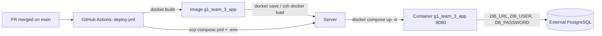

# Deployment

| | |
|---|---|
| **Project** | Adres en Urgencias (repository `Dinez`) |
| **Scope** | How the application is packaged, deployed and operated in production |
| **Related** | [01 Project Structure](../01_project_structure.md) · [02 Collaboration Workflow](../02_collaboration_workflow.md) · [ADR-0005](../decisiones/ADR-0005-production-deployment.md) |

The decisions behind this setup are in [ADR-0005](../decisiones/ADR-0005-production-deployment.md).

---

## 1. Overview



The whole product runs in **one container named `g1_team_3_app`**: the Spring Boot back end exposes the REST API under `/api` and also serves the built React front end. There is **no database container**; the instructor's database is reached through environment variables.

| File | Role |
|---|---|
| `infra/Dockerfile` | Multi-stage build: front end → back end jar (front end embedded) → minimal JRE image |
| `infra/compose.yml` | Runs the `app` service (container name, `.env`, port, restart policy, health check) |
| `.dockerignore` | Keeps the build context small and free of secrets |
| `.github/workflows/deploy.yml` | Builds the image and deploys it on every push to `main` |
| `src/backend/.../config/StaticFrontendConfig.java` | Serves the front end files from `classpath:/static/` |
| `src/backend/.../config/SpaFallbackResourceResolver.java` | Returns `index.html` for client-side routes; API paths and missing files stay 404 |

---

## 2. How the image is built

`infra/Dockerfile` has three stages. The build context is the repository root.

1. **`frontend-build`** (`node:24-alpine`): `npm ci` then `npm run build` in `src/frontend`; output in `dist/`.
2. **`backend-build`** (`eclipse-temurin:25-jdk-alpine`): copies `dist/` into `src/main/resources/static`, then runs `./mvnw package -DskipTests`. The front end ends up inside the jar. Tests are not run here: they already ran in the pull request CI.
3. **Runtime** (`eclipse-temurin:25-jre-alpine`): copies the jar, runs as a non-root user and starts it on port 8080.

Build it locally (from the repository root, requires Docker):

```bash
docker build -f infra/Dockerfile -t g1_team_3_app:latest .
```

Run it locally against a database you can reach:

```bash
docker run --rm -p 8080:8080 --name g1_team_3_app \
  -e DB_URL=jdbc:postgresql://host.docker.internal:5432/urgencias_db \
  -e DB_USER=postgres -e DB_PASSWORD=postgres \
  g1_team_3_app:latest
```

Open <http://localhost:8080>. The build requires `src/frontend/` (with its `package-lock.json`) to exist.

---

## 3. Runtime configuration

The back end reads these variables (see `src/backend/src/main/resources/application.yaml`):

| Variable | Required | Meaning |
|---|---|---|
| `DB_URL` | yes in production | JDBC URL, e.g. `jdbc:postgresql://<host>:5432/<database>` |
| `DB_USER` | yes in production | Database user |
| `DB_PASSWORD` | yes in production | Database password |
| `APP_PORT` | no (default `8080`) | Port published on the server host (read by `compose.yml`) |

Flyway runs the migrations on startup, so there is no separate migration step. Locally the defaults point to `localhost:5432` and nothing has to be set.

---

## 4. Automatic deployment

`.github/workflows/deploy.yml` runs on every **push to `main`** (a merged pull request) and uses the `Production` GitHub environment. Runs never overlap (`concurrency`). Steps:

1. Build the image, tagged `g1_team_3_app:<commit sha>` and `g1_team_3_app:latest`.
2. Configure SSH from the secret key and the pinned host key (strict host key checking).
3. Generate `infra/.env` from the secrets (`umask 077`; values single-quoted so `$` is not interpolated).
4. Create `~/g1_team_3_app` on the server and copy `compose.yml` and `.env` into it.
5. Stream the image: `docker save | gzip | ssh … "gunzip | docker load"`.
6. `docker compose up -d --remove-orphans` and prune dangling images.
7. Poll the container health status for up to 2.5 minutes; the job fails (and prints the last logs) if it does not become `healthy`.

### Server prerequisites

- Linux host with Docker Engine and the Docker Compose plugin.
- A dedicated SSH user, member of the `docker` group, with the **public** key in `~/.ssh/authorized_keys`.
- Port `APP_PORT` (default 8080) reachable by users; the server must be able to reach the database.

### GitHub configuration

Create a **`Production`** environment (Settings → Environments) and add:

| Name | Type | Content |
|---|---|---|
| `VM_KEY` | Secret | Private SSH key (full content, including the `BEGIN`/`END` lines) of the deployment user |
| `DB_URL` | Secret | `jdbc:postgresql://<host>:5432/<database>` |
| `DB_USER` | Secret | Database user |
| `DB_PASSWORD` | Secret | Database password (must not contain a single quote `'`) |
| `VM_HOST` | Variable | Server host name or IP |
| `VM_USER` | Variable | SSH user |
| `VM_KNOWN_HOSTS` | Variable | Output of `ssh-keyscan -H <host>` (pins the server identity) |
| `VM_PORT` | Variable, optional | SSH port, default `22` |
| `APP_PORT` | Variable, optional | Published port, default `8080` |

Generate a dedicated key pair with `ssh-keygen -t ed25519 -f deploy_key -C g1_team_3_deploy -N ""`: the private file goes into `VM_KEY`, the `.pub` file into the server's `authorized_keys`. Never commit either of them.

---

## 5. Operations

On the server, from `~/g1_team_3_app`:

```bash
docker compose ps                 # state and health
docker logs -f g1_team_3_app      # application logs
docker compose restart            # restart without redeploying
docker compose down               # stop and remove the container
```

**Rollback:** re-run the `Deploy` workflow on an earlier commit (Actions → Deploy → *Re-run*), or on the server retag a previous image (`docker tag g1_team_3_app:<sha> g1_team_3_app:latest`) and run `docker compose up -d`.

**Troubleshooting**

| Symptom | Likely cause |
|---|---|
| Job fails at *Transfer the image* with `Host key verification failed` | `VM_KNOWN_HOSTS` is empty or does not match the server |
| `Permission denied (publickey)` | `VM_KEY` does not match the server's `authorized_keys`, or `VM_USER` is wrong |
| Container `unhealthy`, logs show `Connection refused` / `password authentication failed` | Wrong `DB_*` values, or the database is not reachable from the server |
| Page refresh on a front-end route returns 404 | The front end was not built into the image (check the `frontend-build` stage) |
