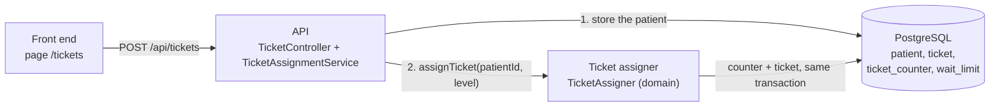

# Ticket API

| | |
|---|---|
| **Project** | Adres en Urgencias (repository `Dinez`) |
| **Scope** | HTTP contract in front of the ticket assigner (REQ-04): what it receives, what it returns, and where each part lives in the code |
| **Related** | [REQ-04 v2](../../business/requirements/REQ-04_v2.md) · [02 Interaction & Data Design v2](../design/02_Interaction_and_Data_Design_v2.md) §1.1 and §3 · [ADR-0006](../decisiones/ADR-0006-ticket-assignment-api.md) |



The Triage and Registration modules do not exist yet. The page `/tickets` plays their role: it sends the patient data and the triage level. The API stores the patient and then calls the ticket assigner of the domain.

---

## 1. Assign a ticket — `POST /api/tickets`

Request body (JSON):

| Field | Type | Rule |
|---|---|---|
| `patientId` | text | Registration number. Required, at most 50 characters. |
| `document` | text | Required, at most 50 characters. |
| `firstName` | text | Required, at most 100 characters. |
| `lastName` | text | Required, at most 100 characters. |
| `level` | number | Triage level, 1 to 5. |

What the API does, in order:

1. Validates the data and rejects a patient who already has a waiting ticket.
2. Inserts the patient in the `patient` table (or updates it if the `patientId` already exists).
3. Level 2 to 5: calls `TicketAssigner.assignTicket(patientId, level)`. Level 1: stops here, the patient goes to immediate care without a ticket.

Answers:

| Case | Status | Body |
|---|---|---|
| Level 2 to 5: ticket assigned | `201` | `{"patientId": "P-1001", "level": 3, "immediateCare": false, "ticketNumber": "T3-015", "arrivalTime": "2026-11-12T15:00:00Z", "position": 3}` |
| Level 1: immediate care, no ticket | `200` | `{"patientId": "P-1001", "level": 1, "immediateCare": true, "ticketNumber": null, "arrivalTime": null, "position": null}` |
| Missing or malformed data | `400` | `{"code": "DATOS_INVALIDOS", "message": "..."}` |
| The patient already has a waiting ticket | `409` | `{"code": "PACIENTE_DUPLICADO", "message": "..."}` |

- `ticketNumber` is `T<level>-<NNN>`: a counter per level and per day. The day ends at midnight in the hospital's time zone (`app.time-zone`, default `America/Bogota`).
- `position` is the place in the queue of that level; a new ticket always goes to the end.
- `arrivalTime` is set by the server and is an ISO-8601 instant in UTC.
- The error codes are the ones defined by the domain exceptions. The front end maps them to Spanish text.
- After a `400` or a `409` nothing is stored: the patient insert runs in a transaction that is rolled back.

Example:

```bash
curl -i -X POST http://localhost:8080/api/tickets \
  -H "Content-Type: application/json" \
  -d '{"patientId":"P-1001","document":"79456123","firstName":"Jorge","lastName":"Castaño","level":3}'
```

## 2. List the waiting queue — `GET /api/tickets`

Answers `200` with the waiting tickets, most urgent level first and, within a level, in order of arrival. This is the order of the queue by level (BR-TRG-02), **not** the order in which patients will be called: the exception of REQ-11 (a ticket that exceeded its wait limit goes first) is not applied here.

`ticketDate` is part of the identity of a ticket: the number restarts every day, but a patient who is still waiting after midnight keeps the ticket of the previous day, so two waiting tickets can have the same `ticketNumber` and different `ticketDate`.

```json
[
  {"ticketDate": "2026-11-12", "ticketNumber": "T2-001", "patientId": "P-1005", "level": 2, "position": 1, "arrivalTime": "2026-11-12T15:10:00Z"},
  {"ticketDate": "2026-11-12", "ticketNumber": "T3-014", "patientId": "P-0999", "level": 3, "position": 1, "arrivalTime": "2026-11-12T14:30:00Z"}
]
```

## 3. Current limits

- Tickets, queues, daily counters and wait limits are stored in the database ([ADR-0007](../decisiones/ADR-0007-persistence-layer.md)); a restart loses nothing. One transaction covers the patient, the counter and the ticket. Concurrent requests are serialised by the database (the counter row lock), so several instances can run.
- The wait limits are read from `wait_limit` but no API edits them yet (REQ-10), and the order in which patients are called (REQ-11) is not implemented.

## 4. Where each part lives

| Part | Code |
|---|---|
| Screen | `src/frontend/src/pages/TicketAssignmentPage.tsx` (route `/tickets`), calls in `src/api/tickets.ts`, texts in `src/i18n/messages.ts` |
| HTTP | `turn/presentation/TicketController`, `presentation/ApiExceptionHandler` |
| Orchestration (store patient, then assign) | `turn/application/TicketAssignmentService` |
| Wiring of the domain objects, hospital clock | `turn/application/TurnConfig` |
| Table `patient` | `turn/persistence/JdbcPatientRepository` |
| Tables `ticket`, `ticket_counter`, `wait_limit` | `queue/persistence/JdbcTicketRepository`, `turn/persistence/JdbcTicketCounterRepository`, `wait/persistence/JdbcWaitLimitRepository` (ports: `TicketRepository`, `TicketCounterRepository`, `WaitLimitRepository`) |
| Ticket assigner (business rules, no state) | `turn/domain/TicketAssigner`, `queue/domain/PriorityQueueManager`, `wait/domain/WaitTimeManager` |

Back-end paths are relative to `src/backend/src/main/java/com/adres/urgencias/`.

Tests: `TicketAssignmentServiceTest` (API behaviour with the real domain, no Spring, no database), `TicketControllerTest` (status codes and JSON), `TicketAssignmentPage.test.tsx` (screen). The domain has its own tests (`TicketAssignerTest`, `PriorityQueueManagerTest`).
