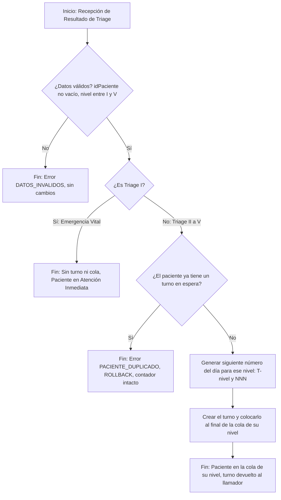

# REQ-04 v2: Asignación Automatizada de Turno según Resultado de Triage

> **Modificación v2:** alineación de REQ-04 con los documentos de diseño (`01_Architectural_and_Detailed_Design_v2.md` y `02_Interaction_and_Data_Design_v2.md`). Cambios principales:
> - El número de turno es un contador diario **por nivel de Triage** (`T3-015` = decimoquinto turno de nivel 3 del día), no del total de pacientes (Q1, nueva `BR-TRG-04`).
> - Triage I: ya no se genera turno ni entrada en la cola. La alerta a reanimación sale del alcance de este REQ (nueva Q3).
> - `BR-TRG-02` reformulada: una cola FIFO por nivel y excepción por límite de espera excedido (REQ-11).
> - Actor y disparador: el módulo de Triage invoca la asignación automáticamente.
> - Nuevos escenarios de error (`DATOS_INVALIDOS`, `PACIENTE_DUPLICADO`) y nueva regla de atomicidad (`BR-TRG-05`).
> - `CON-TRG-02` incluye la unicidad diaria del número. Nuevas `CON-TRG-03` (persistencia) y `AS-TRG-03`.
> - Dependencias ampliadas (REQ-05, REQ-10, REQ-11); la publicación en pantallas se traslada a REQ-06.
> - Trazabilidad hacia adelante enlazada con componentes y clases del diseño; Quality Gate actualizado.

**Integrantes del Equipo:**
- Bryan Gustavo Llontop Angulo (@BLlontopSec)
- Diego Stevan Anacona Velez (@elDIEGO12)
- Diego Ibáñez (@Dielix22)
- Adrien ROHO (@hoverwars)
- Sebastian Eisneider Rey Pretel (@sereypretel)

**ID del Requerimiento:** REQ-04  
**Título del Requerimiento:** Asignación de Número de Turno para el Paciente Basado en Triage  
**Módulo:** Gestión de Triage y Colas de Atención  

---

## 1. Visión General (Overview)

* **Declaración del Requerimiento (Statement):**  
  Usando el resultado del triage, el sistema debe asignar automáticamente un número de turno priorizado para el paciente y posicionarlo en la cola de atención médica.

* **Tipo de Requerimiento:**  
  Funcional.

* **Fuente / Evidencia (Source / Evidence):**  
  Hoja de Descubrimiento (Clase 8) — Hallazgo #04: *"Falta de visibilidad, desorden en el llamado de pacientes en sala de espera y quejas por aparente desatención a casos prioritarios"*.

* **Necesidad (Need):**  
  Establecer un mecanismo de ordenamiento objetivo y automatizado en la sala de espera que reemplace el orden de llegada por un modelo basado en la gravedad clínica.

* **Valor / Justificación (Value / Rationale):**  
  Posicionar al paciente de forma transparente en la cola de espera respetando su urgencia clínica, para garantizar que los casos de mayor riesgo vital se atiendan dentro de los tiempos estipulados. La publicación del turno en las pantallas de la sala de espera se especifica en REQ-06.

---

## 2. Contexto (Context)

* **Regla de Negocio (Business Rule):**  
  `BR-TRG-02`: El sistema mantiene una cola de espera por cada nivel de Triage de II a V (cuatro colas, orden de llegada dentro de cada una). El orden de atención prioriza siempre el nivel de Triage (`II > III > IV > V`) y, dentro de un mismo nivel, el orden cronológico de ingreso al sistema. **Excepción:** un turno que haya excedido el tiempo límite de espera de su nivel (REQ-10) se atiende antes que los demás, aunque su nivel sea menos prioritario (REQ-11).

  `BR-TRG-03`: Un paciente con un nivel de Triage I no pasa por el algoritmo de gestión de turno: no se le genera número de turno ni entrada en ninguna cola, y se atiende de inmediato. El nivel I se conserva como nivel de Triage del paciente.

  `BR-TRG-04`: El número de turno tiene la forma `T<nivel>-<NNN>` (ej. `T3-015`), donde `<nivel>` es el nivel de Triage (2 a 5) y `<NNN>` es un contador de tres dígitos **propio de ese nivel y de ese día**: `T3-015` es el decimoquinto turno de nivel 3 del día. Los contadores arrancan en `001` y se reinician cada día, a medianoche (ver Q1).

  `BR-TRG-05`: Un número de turno solo se consume si el turno se crea. La generación del número, la creación del turno y su colocación en la cola ocurren en una sola transacción: si falla alguno de los pasos, ninguno se aplica y el contador no avanza.

  `BR-TRG-06`: Un paciente no puede tener más de un turno en espera al mismo tiempo.

* **Restricción (Constraint):**  
  `CON-TRG-02`: El número de turno generado por el sistema es inalterable por el personal médico ni el paciente, es decir no puede ser modificado manualmente por el personal médico, administrativo ni por el paciente. Además, el número es único dentro de un mismo día, y el único camino para crearlo es la asignación automática de este requerimiento.

  `CON-TRG-03`: El turno, su posición en la cola y los contadores diarios son datos persistentes: deben sobrevivir a un reinicio del sistema (PostgreSQL, ADR-0001).

* **Supuesto (Assumption):**  
  `AS-TRG-02`: Se asume que el profesional de enfermería/médico ya completó y guardó la valoración clínica del paciente en el módulo de Triage previo.

  `AS-TRG-03`: Se asume que el módulo de Triage invoca la asignación automáticamente al guardar el resultado (`asignarTurno(idPaciente, nivel)`), sin intervención manual del personal para generar el turno.

* **Dependencia (Dependency):**  
  `DEP-TRG-02`: Depende de 
  - `REQ-01`: Registro del paciente
  - `REQ-02`: Registrar los signos vitales del paciente en el sistema
  - `REQ-03`: Cálculo del nivel de prioridad usando el triage

  `DEP-TRG-03`: Está relacionado con los siguientes requerimientos que se apoyan en la misma cola o la modifican:
  - `REQ-05`: Actualización del nivel de Triage de un paciente cuyo estado se deteriora; el turno se reubica en la cola del nuevo nivel.
  - `REQ-06`: Visualización de la cola en las pantallas de la sala de espera.
  - `REQ-10`: Tiempo límite de espera editable por nivel de Triage (niveles 2 a 5).
  - `REQ-11`: Retiro del paciente más prioritario de la cola, con prioridad a quien excedió su límite de espera.

* **Riesgo (Risk):**  
  `RSK-TRG-02`: Acumulación de pacientes de menor prioridad (Triage IV y V) con tiempos de espera indefinidos durante jornadas de alta concurrencia de emergencias. *Mitigación:* el límite de espera por nivel (REQ-10) y la excepción de `BR-TRG-02` (REQ-11) hacen que un turno que excede su límite pase antes que los demás.

* **Preguntas Abiertas (Open Questions):**  
  * `Q1`: ¿Los números de turno se reinician cada día, a medianoche, y la primera asignación de cada nivel comienza en `001`? Proponemos el formato `T3-015` (ver `BR-TRG-04`): `T3` es el nivel de Triage y `015` es el decimoquinto turno de ese nivel hoy. Los diseños lo adoptan como supuesto y la pregunta sigue abierta.

  * `Q2`: ¿Qué sucede si el paciente abandona su turno? (Los diseños solo registran el retiro de la cola con `hora_retiro`; no distinguen entre «llamado» y «abandono».)

  * `Q3`: ¿Quién y cómo alerta a reanimación cuando un paciente es Triage I? Este requerimiento solo garantiza que no se genere turno ni entrada en cola (`BR-TRG-03`). La alerta no está cubierta por los diseños actuales y no es parte de REQ-04.

---

## 3. Prioridad y Estimación (Priority & Estimation)

* **Modelo de Priorización Aplicado:**  
  MoSCoW. Utilizamos esta metodología porque nos faltan elementos para calcular a las variables de la fórmula RICE.

* **Prioridad Asignada:**  
  **Must Have (Crítico)**.

* **Argumentación de Prioridad:**  
  Sin la asignación automatizada del turno, el resultado del Triage es inútil a nivel operativo. El sistema no tendría cómo indicar qué paciente sigue ni reflejar el orden en las pantallas, bloqueando el llamado médico.

* **Estimación Basada en Confianza:**  
  * **Nivel de Confianza:** Alto (90%).  
  * **Estimación:** Parece complicado pero nos faltan elementos para establecer una estimación del nivel de complejidad.

---

## 4. Representaciones (Representations)

### 4.1. Historia de Usuario (User Story)

**Como** módulo de Triage (disparado por el resultado guardado por la enfermera / el médico de Triage),  
**Quiero** que el sistema asigne automáticamente un número de turno priorizado a partir del resultado del Triage,  
**Para** posicionar al paciente de forma transparente en la cola de espera respetando su urgencia clínica.

---

### 4.2. Criterios de Aceptación (Acceptance Criteria - BDD)

* **Escenario 1: Asignación de turno estándar (Flujo Principal)**
  * **Dado** que se ha guardado exitosamente el resultado del Triage de un paciente con nivel II a V y sin turno en espera,
  * **Cuando** el sistema procesa el resultado,
  * **Entonces** genera el siguiente número del día para ese nivel con el prefijo correspondiente (ej. `T3-015`), lo coloca al final de la cola de su nivel y devuelve el turno asignado. La publicación en las pantallas se realiza según REQ-06.

* **Escenario 2: Bypass por Emergencia Vital (Triage I)**
  * **Dado** que el resultado del Triage guardado es "Triage I" (Reanimación),
  * **Cuando** el sistema procesa el resultado,
  * **Entonces** el sistema no genera número de turno, no crea entrada en ninguna cola ni cambia ningún contador, y el paciente debe ser tratado inmediatamente por los médicos (ver Q3 para la alerta a reanimación).

* **Escenario 3: Desempate por hora de llegada**
  * **Dado** que la cola ya tiene pacientes en espera nivel Triage III,
  * **Cuando** ingresa un nuevo paciente clasificado como Triage III,
  * **Entonces** el sistema le asigna un número de turno y lo ubica en la cola detrás del último paciente Triage III existente, respetando el orden de llegada entre ellos.

* **Escenario 4: Paciente duplicado**
  * **Dado** que un paciente ya tiene un turno en espera (ej. `T3-015`),
  * **Cuando** el módulo de Triage solicita asignarle otro turno,
  * **Entonces** el sistema rechaza la solicitud con el error `PACIENTE_DUPLICADO`, no crea un segundo turno, el contador del nivel no avanza y el turno existente queda intacto.

* **Escenario 5: Datos inválidos**
  * **Dado** que la solicitud llega con un identificador de paciente vacío o con un nivel de Triage nulo o fuera del rango de 2 a 5,
  * **Cuando** el sistema procesa la solicitud,
  * **Entonces** la rechaza con el error `DATOS_INVALIDOS` y no escribe ningún dato (ni turno, ni entrada de cola, ni contador).

* **Escenario 6: Primer turno del día**
  * **Dado** que aún no se ha asignado ningún turno de nivel IV en el día actual,
  * **Cuando** ingresa un paciente clasificado como Triage IV,
  * **Entonces** el sistema le asigna el turno `T4-001`, sin importar cuántos turnos de otros niveles existan (ver Q1).

---

### 4.3. Caso de Uso y Diagrama de Flujo (Use Case & Flow Diagram)

* **Actor:** Módulo de Triage (disparado por el resultado guardado por la enfermera / el médico de Triage).
* **Meta:** Asignar un turno y posicionar al paciente en la cola de espera según su gravedad.
* **Precondición:** Paciente valorado, con nivel de Triage I, II, III, IV o V guardado en base de datos.
* **Postcondición (Triage II a V):** Número de turno `T<nivel>-<NNN>` generado e insertado al final de la cola de su nivel, en una sola transacción. **(Triage I):** ningún turno generado.
* **Flujos de excepción:** `DATOS_INVALIDOS`, `PACIENTE_DUPLICADO` (sin cambios en datos).

#### Diagrama de Flujo de Caso de Uso (Mermaid)

*Nota:* el orden entre niveles y la excepción por límite de espera excedido (REQ-11) se aplican cuando se retira un paciente de la cola, no al insertarlo (ver `BR-TRG-02`).

---

## 5. Trazabilidad e Impacto (Traceability & Impact)

* **Trazabilidad hacia Atrás (Backward Traceability):**  
  Este requerimiento se origina para resolver el caos organizativo documentado en la fase de descubrimiento (Hallazgo #04). Como el flujo de pacientes presenta niveles de gravedad que varían constantemente, asignar el orden de atención de forma manual o por simple llegada genera un riesgo clínico inaceptable. Necesitamos este requerimiento para garantizar un orden estricto que proteja a los pacientes: no solo evita el desorden en la sala de espera, sino que asegura que quienes tienen heridas o condiciones de mayor riesgo vital sean atendidos primero, evitando que su salud se deteriore mientras esperan.

* **Trazabilidad hacia Adelante (Forward Traceability):**  
  * **Arquitectura:** (`01_Architectural_and_Detailed_Design_v2.md`, sec. 6)
    * Componentes: *Asignador de turno* y *Gestionador de cola de prioridad*.
    * Clases: `AsignadorDeTurno`, `Turno`, `GestionadorColaPrioridad`, `ColaPorNivel`, `NivelTriage`.
    * Decisión: ADR-0002 (una cola FIFO por nivel de Triage).
  * **Interacción y datos:** (`02_Interaction_and_Data_Design_v2.md`) caso de uso 1.1 (añadir un paciente a la cola), modelo de datos (`paciente`, `turno`, `contador_turno`, `cola_por_nivel`, `entrada_cola`) y contrato de `asignarTurno` (sec. 3).
  * **Pantallas de la sala de espera:** la publicación se especifica en REQ-06 (componente *Visualización de cola*), fuera del alcance del diseño detallado de este requerimiento.
  * **Pruebas:** Define los casos:
    * `TEST-REQ04-SortPriority`: Valida que un Triage de mayor gravedad se atienda antes que uno de menor gravedad (cuando ninguno excede su límite de espera).
    * `TEST-REQ04-SameTriageOrder`: Valida el desempate cronológico cuando ingresan pacientes con el mismo nivel de Triage.
    * `TEST-REQ04-Triage1-Bypass`: Valida que el Triage I no genere turno, entrada de cola ni avance de contador.
    * `TEST-REQ04-TurnNumber`: Valida el formato `T<nivel>-<NNN>`, el contador por nivel y el reinicio diario (Q1).
    * `TEST-REQ04-Duplicate`: Valida el error `PACIENTE_DUPLICADO` sin cambios en el contador ni en el turno existente.
    * `TEST-REQ04-InvalidData`: Valida el error `DATOS_INVALIDOS` para id vacío y nivel nulo o fuera de rango.
    * `TEST-REQ04-Atomicity`: Valida que, ante un fallo, el contador no avance y no queden turno ni entrada de cola (`BR-TRG-05`).
  
  > La prueba `TEST-REQ04-SendNotificacion` (emisión del turno hacia las pantallas públicas) se traslada a REQ-06.

* **Análisis de Impacto:**  
  Un fallo en este componente desordenaría la atención médica, impactando directamente al módulo de atención médica (llamado de pacientes desde consultorio, REQ-11), a la actualización de nivel de Triage (REQ-05), a la visualización de la cola (REQ-06) y alterando los indicadores de tiempos de atención enviados a Estadística.

---

## 6. Validación — Puerta de Calidad (Quality Gate)

| Criterio de Calidad                                                                                                         | Estado     | Justificación / Observación                                                                                                                                                                                                                                                                                                                          |
|-----------------------------------------------------------------------------------------------------------------------------|------------|------------------------------------------------------------------------------------------------------------------------------------------------------------------------------------------------------------------------------------------------------------------------------------------------------------------------------------------------------|
| :---                                                                                                                        | :---:      | :---                                                                                                                                                                                                                                                                                                                                                 |
| 1. **¿Válido?** ¿Refleja una necesidad real y evidenciada, no inventada?                                                    | [x] Cumple |                                                                                                                                                                                                                                                                                                                                                      |
| 2. **¿Claro / Sin ambigüedad?** ¿Existe una sola interpretación razonable?                                                  | [x] Cumple | El formato del número de turno (contador por nivel y por día) se precisa en `BR-TRG-04`. Queda abierta únicamente la confirmación del reinicio diario (Q1).                                                                                                                                                                                           |
| 3. **¿Atómico?** ¿Es una única expectativa comprobable de forma independiente, no varias agrupadas?                         | [x] Cumple | La publicación en pantallas se trasladó a REQ-06 y la alerta a reanimación quedó fuera de alcance (Q3), de modo que REQ-04 se limita a asignar el turno y posicionarlo en la cola.                                                                                                                                                                    |
| 4. **¿Necesario?** ¿Eliminarlo rompe realmente algo?                                                                        | [x] Cumple |                                                                                                                                                                                                                                                                                                                                                      |
| 5. **¿Factible?** ¿Se puede construir de forma realista con lo que tiene el equipo?                                         | [x] Cumple | El diseño de arquitectura y de datos ya está definido (documentos 01 y 02 v2, ADR-0001 y ADR-0002, PostgreSQL con transacciones). El riesgo restante es la publicación en pantallas, que ahora pertenece a REQ-06.                                                                                                                                     |
| 6. **¿Verificable?** ¿Se puede demostrar concretamente si se cumple?                                                        | [x] Cumple | Cubierto por los escenarios BDD 1 a 6 y por los siete casos de prueba de la sec. 5.                                                                                                                                                                                                                                                                   |
| 7. **¿Consistente?** ¿Entra en conflicto con algún otro requerimiento del conjunto?                                         | [x] Cumple | `BR-TRG-02` incluye ahora la excepción de REQ-11 (límite de espera excedido). RF-06 de `requerimientos_v2.md` ya no es sobre el cambio de prioridad, así que el conflicto anterior desaparece. El cambio de nivel de REQ-05 se resuelve con `actualizarNivelTriage`, que reubica el turno en la cola del nuevo nivel. |
| 8. **¿Suficientemente completo?** ¿Faltan funciones o restricciones importantes?                                             | [x] Cumple | Se añadieron casos de error, atomicidad, unicidad y persistencia. Quedan preguntas abiertas sobre el abandono de turno (Q2) y la alerta a reanimación (Q3).                                                                                                                                                                                           |
| 9. **¿Trazable?** ¿Cada parte del documento se puede rastrear hasta evidencia real, sin inventarse para llenar una sección? | [x] Cumple | Trazabilidad hacia atrás al Hallazgo #04 y hacia adelante a los documentos de diseño v2 (componentes, clases, ADR, modelo de datos).                                                                                                                                                                                                                  |
